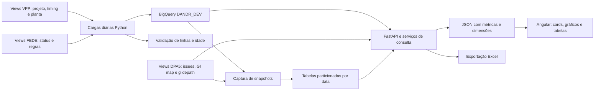

# Panorama de dados — D&R Dashboard

## 1. Qual versão e quais evidências

Backend: `fix/dpa5-program-filter-snapshot`, commit `6bcd7ae`, 31/08/2026. Frontend: `develop`, commit `f24ae41`, mesma data. [SOURCE-VERSIONS.json](SOURCE-VERSIONS.json) registra a importação. São as versões mais recentes disponíveis localmente: o acesso institucional suspenso impediu buscar commits posteriores.

**As queries BigQuery foram recuperadas.** A documentação inicial considerou a main local de 2025 e estava incompleta. Este documento a substitui. O panorama explica o código; os apêndices catalogam as funções, parâmetros, rotas e templates SQL com links para suas linhas. Não executamos queries na empresa, portanto resultados, custos, volumes e SLAs reais não foram medidos.

## 2. Fluxo completo



Há uma etapa de preparação dos dados e outra de consulta para apresentação. O Angular não acessa BigQuery diretamente. O backend executa SQL, converte resultados e entrega contratos HTTP. A linhagem comprovada começa nas views corporativas: o processo anterior de ingestão dessas views não está neste projeto.

Na demo, o fluxo é Angular → FastAPI local → registros sintéticos → agregações → JSON/Excel. As queries originais permanecem no repositório para estudo; não alimentam a demo.

## 3. Estrutura

| Caminho | Responsabilidade |
| --- | --- |
| `back/app/main.py` | Entrada da API mock, sem login ou BigQuery |
| `docs/original/backend_main.py` | Entrada original, routers e segurança Entra |
| `back/app/routes/` | Endpoints, parâmetros e delegação |
| `back/app/services/` | Queries, agregações, normalização e Excel |
| `back/app/services/bigquery_client.py` | Projetos, datasets e cliente BigQuery |
| `back/app/services/demo_service.py` | Registros sintéticos e cálculos da demo |
| `back/app/controllers/`, `schemas/`, `models/`, `core/` | Orquestração, contratos, modelos e configuração preservados |
| `back/scripts/` | Refresh, snapshots, verificação de schema e utilitários |
| `front/dandr-web/src/app/services/` | Clientes HTTP Angular |
| `front/dandr-web/src/app/dashboard/` | Telas, filtros e gráficos |
| `front/dandr-web/src/app/shared/state.service.ts` | Estado compartilhado entre telas e sidebar |
| `front/dandr-web/public/` | Imagens e fonte originais |
| `run-demo.sh` | Inicialização no Mac |

Código e estrutura recentes foram importados. Banco `.db`, planilhas/dumps com dados reais, credenciais, ambientes virtuais e histórico institucional ficaram fora. `requirements_install.txt` é o manifesto original; `requirements-demo.txt` atende a demonstração.

## 4. Como BigQuery funcionava

Projeto principal: `ford-ae4fa4b1aca14194fe8e5c19`, dataset `DANDR_DEV`. Projeto de views externas: `prj-dfad-1242-uapd-p-1242`. O helper `get_table_path()` resolve `project.dataset.table` por aliases. Há configuração BOM para `bq_284_fedebom_lc_vw`, mas o serviço recente de custos lê tabelas em DANDR_DEV.

O cliente original usa `bigquery.Client(project=PROJECT_ID)`, deixando a biblioteca resolver as credenciais do ambiente. Isso não prova qual conta de serviço/IAM estava efetivamente configurada. Autenticação Entra do usuário na API e credenciais Google do backend são mecanismos distintos.

Padrão de consulta: SQL + filtros → parâmetros em `QueryJobConfig` → `client.query()` → `.result()` ou `.to_dataframe()` → conversão de nulos, datas, números → JSON. Muitos métodos usam `ScalarQueryParameter`/`ArrayQueryParameter`; alguns, como a pesquisa Vehicle Line, interpolam texto. Não afirmar que todas as queries são parametrizadas.

Na cópia pessoal, `get_client()` bloqueia a nuvem por padrão. A entrada mock não importa os serviços BigQuery. Os scripts de refresh são material de estudo e não são executados por `run-demo.sh`.

## 5. Alimentação diária

`run_daily_refresh.py` documenta execução como Cloud Run Job acionado por Cloud Scheduler. O cron, fuso, configuração implantada e histórico real de execuções não estão nesses arquivos. O script roda oito jobs sequencialmente, registra log diário, continua após falhas para produzir um resumo e retorna código 1 se houver erro.

| Ordem | Script | Fonte | Destino em DANDR_DEV |
| --- | --- | --- | --- |
| 1 | `refresh_vehicle_line.py` | Views VPP 001, 005, 012 e 021 | `vehicle_line` |
| 2 | `refresh_fede_daily_status.py` | `bq_707_fedve_daily_lc_vw.fede_dv_status_vw` | `fede_daily_fedestatus` |
| 3 | `refresh_assessment.py` | `bq_707_fedve_daily_lc_vw.assessment_vw` | `fede_daily_assessmentvw` |
| 4 | `refresh_dr_design_rule.py` | `bq_707_fedve_daily_lc_vw.dr_design_rule_vw` | `dr_design_rule` |
| 5 | `refresh_dr_mapping.py` | `bq_707_fedve_daily_lc_vw.dr_mapping_vw` | `dr_mapping` |
| 6 | `refresh_dr_pk.py` | `bq_707_fedve_daily_lc_vw.pk_vw` | `fede_daily_pkvw` |
| 7 | `refresh_drassesmentvw.py` | `bq_707_fedve_daily_lc_vw.dr_assessment_vw` | `drassesmentvw` |
| 8 | `refresh_requirementvw.py` | `bq_707_fedve_daily_lc_vw.requirement_vw` | `fede_daily_requirementvw` |

Os oito usam **CREATE OR REPLACE TABLE AS SELECT**: recarga completa, não CDC/merge incremental. Sete copiam uma view com SELECT *. Vehicle Line consolida quatro fontes.

Vehicle Line faz FULL OUTER JOIN de `vpp001_glb_integrator_prj_vw` e `vpp005_prj_timing_pivot_vw` por `vpp001_gi_prj_id`. COALESCE aproveita metadados de ambos os lados; `b2.* EXCEPT(...)` mantém colunas restantes de timing. LEFT JOINs em Effective Point acrescentam plantCode/plantName via `vpp012_fedebom_decoder_vw` e WERS plant via `vpp021_wers_vpid_decoder_vw`. DISTINCT nos subselects não garante unicidade por chave; a cardinalidade precisa ser validada nos dados.

O refresh Vehicle Line compara schemas antes/depois e registra colunas adicionadas, removidas ou com tipo alterado. Ao fim, se nenhum job falhou, `verify_data_readiness.py` verifica acesso/existência, `num_rows > 0` e idade de `modified` ≤24h nas oito tabelas. Essa idade é do objeto BigQuery, não necessariamente do evento de negócio.

**Fronteira não resolvida:** as queries usam `dvp_fede`, `bom_piece_cost`, `bom_tooling_cost` e `fede_daily_drassesmentvw`, mas os oito jobs não criam essas tabelas. O refresh escreve `drassesmentvw`, enquanto HIR lê `fede_daily_drassesmentvw`. Pode haver transformação externa ou divergência de versão; não inventar o elo faltante.

## 6. Snapshots

`capture_weekly_snapshots.py` cria `dpa5_weekly_snapshot` e `dvp_weekly_snapshot`, particionadas por `snapshot_date`, e insere a data UTC de execução. O nome indica intenção semanal, mas a agenda efetiva não está comprovada.

DPA5 lê `dpa5_issue_list_field_raw_vw`, normaliza K-PAC com REGEXP_REPLACE/SPLIT/UNNEST, converte contagens com SAFE_CAST/COALESCE e agrega por **CPSC + lead_pmt + program + k_pac_id**. Conta dashboard_ids distintos e soma estados.

DVP lê `dvp_fede`, extrai ano de program, normaliza marco e estado e agrega por **GI + PMT + model_year + milestone_code**. Guarda Meet, Does Not Meet, Unassessed e total.

Os INSERTs não são precedidos de DELETE/MERGE: repetir o job no mesmo dia pode duplicar snapshots. Não há transação conjunta entre DPA5 e DVP; falha no segundo pode deixar o primeiro concluído. O handler imprime a exceção sem relançá-la.

Há uma divergência de contrato: o DDL do snapshot DVP é agregado, enquanto algumas queries de glidepath o selecionam como fonte esperando colunas detalhadas como program, sched_finish e conformance_state. É necessário conferir o schema real para comprovar esse caminho histórico.

## 7. Chaves, seletores e informações do cabeçalho

| Campo | Origem/papel |
| --- | --- |
| `gi_code` | `vpp001_gi_prj_id`, distribui o contexto do projeto |
| `program_code` | Na versão recente é `vpp001_gi_prj_ds`, descrição do projeto |
| `program_name` | `vpp001_gi_prod_pgm_ds` |
| `model_year` | `vpp001_veh_mdl_yr`; normalizado conforme a query |
| `effectivein` | Effective Point; filtro principal de custos |
| `cpsc` | Commodity |
| `pmt`/`pmt_code` | Sidebar 100…600; fontes podem usar 1…6 ou descrição com prefixo |
| `dvp_team` | Equipe de validação |
| `assessment_id`/`requirement_id` | Grãos diferentes: avaliação e requisito |
| `pk1`, `pk4`, `dr_pk2`, `dr_pk4_rec`, `pk_rec` | Chaves compostas usadas em parsing e joins |
| `milestone_date` | Data de marco, distinta de snapshot_date |

Home pesquisa `/search/model-years`, `/search/program-names` e `/search/program-codes`. Search chama `/vehicle-line/`. O serviço consulta vehicle_line, filtra, ordena e escolhe a primeira linha ou selected_index. Retorna GI, descrição, PTVL/código e descrição, programa, Effective Point, nameplate, ano, planta/WERS e marcos. `parseSummary()` também divide o texto por `|` e `:`. `StateService` propaga programa, GI, PMT, equipe, marco e painel ativo.

## 8. Pipeline de cada tela

### CAE Status

Endpoint `/fede-status/metrics/cae-total-assessments` → `get_cae_total_assessments` → `dvp_fede`. Filtra GI, prototype_type contendo CAE, estado não nulo/vazio, commodity ou programa e PMT. Agrupa por GI/programa. COUNT(*) é total; COUNTIF calcula Meet/Pass, Unassessed, Approved Deviation, Does Not Meet, Cannot Assess e Not Applicable. O Angular agrega grupos para cards/donut e divide categoria pelo total.

Há também consultas detalhadas e `/metrics/cae-graph`; os componentes legados não são necessariamente todos montados na tela principal. Use o template Home para identificar o ativo e o apêndice para os SQLs completos.

### DVP Assessment

`/fede-status/metrics/conf-state` chama `count_conf_state_results`; `/metrics/dvp-team-list` chama `get_metrics_by_dvp_team_list`. As queries contam estados por contexto e oferecem recortes GI, equipe, PMT e snapshot conforme o método. O serviço normaliza PMT numérico para aceitar código canônico e prefixo de origem. Assessment conta avaliações; não equivale automaticamente a requisitos únicos.

### DVP Classification

`/api/v1/fede-status/dvp-classification` → `get_dvp_classification_metrics` → `fede_daily_requirementvw`. Resolve programa pelo GI, limpa pontuação, usa slug dos três primeiros tokens e filtra o segmento inicial de pk1 e CPSC. Agrupa por requirement_id e usa MAX do indicador de classificação: uma ocorrência não nula diferente de Not Classified/Not Applicable torna o requisito classificado. Não classificados = total − classificados; percentual = classificados/total ×100. **snapshot_date é ignorado nessa função**, pois a tabela não possui essa coluna.

### DVP Glidepath

`/api/v1/dvp-glidepath/{pmts,milestones,data,snapshots}` usa `dvp_glidepath_service.py`. Filtra GI, PMT, marco e snapshot. Extrai ano de program e datas com SAFE_CAST: sched_finish, actual_end_date, milestone_date e demais marcos. O Angular constrói curvas de conclusão a partir de término planejado/real. A troca da fonte live para snapshot exige conferir a divergência de schema da seção 6. Há exportação própria de glidepath.

### Design Rules

Evidences: `/fede-status/metrics/dr-evidences-by-assessment` → `get_dr_evidences_by_assessment` → `dvp_fede`. Agrupa por GI, assessment, CPSC, ano e campos de marco; conta Meet/Pass, Does Not Meet e Unassessed. O denominador visual pode considerar somente essas três categorias.

Classification: `/fede-status/metrics/design-rule-classification` → `get_design_rule_classification` → `dr_design_rule`. Sem GI direto, extrai ano/programa de dr_pk2, normaliza espaços/underscores e tenta prefixos progressivamente menores. Conta Applicable, Carryover/Previously Validated, Not Applicable e Not Classified. A resposta informa matched_prefix. O fallback pode ampliar o conjunto; não é uma chave estrangeira garantida.

### HIR

`/api/v1/fede-status/hir-completion` → `get_hir_completion_metrics`. CTE base_dr lê `fede_daily_drassesmentvw`, filtra source HIR, converte dr_pk4_rec e normaliza has_evidence. CTE base_status lê `fede_daily_fedestatus` com DISTINCT, converte pk_rec, extrai programa de pk4 e aplica filtros. INNER JOIN une as chaves convertidas.

Agrupa programa/GI/marco/equipe/PMT/CPSC. With Evidence conta Y, Without Evidence conta N, Total conta todas as linhas; Completion = ROUND(SAFE_DIVIDE(count Y,total)*100,1). Outros valores podem entrar no denominador sem entrar em Y/N. Cardinalidade do join deve ser validada para evitar duplicação.

### DPA5

`/dpa5/summary` → `get_dpa5_summary` → `get_dpa5_data`. Fontes externas no dataset `bq_666_dpa5_lc_vw`: `dpa5_issue_list_field_raw_vw`, `dpa5_glidepath_date_raw_vw`, `dpa5_dashboard_id_gp_id_raw_vw`.

Primeiro resolve dashboard_ids pelo GI map. Sem correspondência, usa CPSC informada ou CPSCs do GI em dvp_fede. Resolve programas-base e aplica filtro de programa em suas estratégias; sem base pode usar AND 1=0. PMT 200 vira prefixo `2 -%` de lead_pmt. K-PAC é separado/normalizado antes de agregações e associação a metas.

O resumo soma as categorias dos registros; a composição exata de not assessable consta em get_dpa5_summary. As metas são agrupadas por data e frações podem virar percentuais. Sem marcos do join embutido, há fallback via CPSCs. O código reutiliza totais atuais nas datas passadas e zera datas futuras: isso **não é um histórico observado completo**. compliance_prediction pode ser None; não existe evidência de um modelo de machine learning.

### Costs

`/cost/metrics/{piece,tooling,combined}` usa `cost_service.py`, lendo `DANDR_DEV.bom_piece_cost` e `bom_tooling_cost`. O preenchimento dessas tabelas não está nos oito refreshs. Filtros: effectivein, effectiveout vazio/nulo, CPSC, peça/PMT conforme método; custo real deve ser positivo. `resolve_pmt` converte 100…600 em 1…6.

Campos: peça, programa, vehicleline, commodity/nome, real/meta, moeda, gap e referência; tooling também planta/funding source. Gap = real − meta. Backend soma os custos; Angular agrupa por commodity e peça e produz tabela expansível. `/cost/dropdowns` reúne seletores; combined reúne totais. Tooling e custo unitário têm naturezas diferentes: o card combinado não comprova custo industrial total sem volume e moeda normalizados.

### Milestone Readiness

`/api/v1/milestone-readiness/{gi}` consulta `vehicle_line`, valida marco e executa três queries em paralelo: DVP, CAE e Design Rules. DVP/CAE recortam avaliações devidas até a data, distinguem CAE por prototype_type e contam concluídas conforme `_COMPLETED_STATES`.

Design Rules não filtra data: no SQL, Target = Applicable + Carryover + Previously Validated; Actual = Carryover + Previously Validated. O comentário da função difere do SQL; a query é a referência da implementação. Percentual = actual/target ×100, zero com target zero. Green ≥100%, Yellow ≥80%, Red abaixo disso. Falhas são registradas por fonte; zero e erro não são equivalentes.

## 9. Excel

`export_routes.py` delega para `excel_export_service.py`: CAE, DVP, DVP Glidepath, HIR, Design Rules, DPA5 e custos possuem queries próprias, incluídas no apêndice. Exportar não significa necessariamente baixar somente as linhas visíveis. O frontend pede blob e cria uma URL temporária de download.

Na demo, o arquivo contém registros sintéticos filtrados e uma aba About; não replica todos os templates corporativos. Os serviços originais de Excel permanecem para estudo.

## 10. Pontos de atenção para a entrevista

- A linhagem anterior às views e alguns objetos derivados não são definidos nesta base. Não inventar essa ingestão.
- Refresh completo não é incremental, e o conjunto de oito tabelas não é atualizado atomicamente.
- Os snapshots não são idempotentes e o DVP apresenta diferença de schema entre produtor e consumidor.
- `get_dpa5_snapshots` aparece duas vezes: a última definição prevalece e lista datas sem filtrar GI, apesar do parâmetro.
- Algumas queries retornam vazio em caso de exceção; outras propagam. Tela vazia pode esconder erro.
- A validação de modified mede atualização da tabela, não completude/frescor de todos os eventos.
- Não há evidência suficiente para afirmar clustering universal, volumes, custos, cron implantado ou SLA medido.
- O original combina normalização de PMT, parsing de chaves, COUNTIF, SAFE_CAST, SAFE_DIVIDE, UNNEST, agregação por grão e API tipada: estes são pontos demonstráveis no código.

## 11. Roteiro de apresentação

“O projeto separa preparação diária e consulta de indicadores. Views corporativas eram materializadas em tabelas de consumo no BigQuery. Os serviços Python aplicavam filtros e agregações e entregavam JSON/Excel. O Angular coordenava programa, PMT, commodity, equipe e snapshot. Esta cópia mantém a estrutura e as queries, com dados sintéticos para apresentar.”

Mostre Vehicle Line/GI → CAE com mudança de PMT → DVP/snapshot → custos por commodity → Excel → query e refresh da fonte. Diferencie o que o código prova da sua experiência pessoal e dos dados indisponíveis. Os mocks não são validação de equivalência das queries corporativas.

## 12. Rodar no Mac

### Neste Mac, na cópia já preparada

Abra o Terminal e cole:

```bash
cd "/Users/gabrielaragao/Documents/Codex/2026-09-08/eu-perdi-acesso-ao-meu-computador/outputs/engineering-demo"
./run-demo.sh
```

Espere aparecer `Dashboard: http://localhost:4200`, mantenha o terminal aberto e acesse **http://localhost:4200**. A API fica em **http://localhost:8000/docs**. Encerre com **Control+C**.

Pesquise ano **2026**, código **AU-01**, programa **Aurora EV** e clique Search. Em Costs, selecione PMT **100**. Outro programa: **OR-02 / Orion Hybrid**.

### Clone novo ou outro Mac

Requisitos: Python 3.11+, Node.js 22.12+ e pnpm 11 (`npm install -g pnpm@11`). Faça login no GitHub pessoal se o repositório for privado.

```bash
git clone https://github.com/gabrielfrz/ford-mockado.git
cd ford-mockado
./run-demo.sh
```

A primeira instalação precisa de internet. O script cria back/.venv, instala dependências mock, compila Angular e sobe os dois serviços. Neste Mac também pode usar o runtime do Codex. Não é necessário gcloud, BigQuery, banco ou login institucional.

### Desenvolvimento com recarga

Depois da instalação inicial, use dois terminais na raiz, sem run-demo.sh simultâneo:

```bash
# Terminal 1
back/.venv/bin/python -m uvicorn app.main:app --app-dir back --host 127.0.0.1 --port 8000 --reload
```

```bash
# Terminal 2, Node/pnpm no PATH
cd front/dandr-web
pnpm start --host 127.0.0.1
```

### Verificação

```bash
curl http://localhost:8000/health
# Deve indicar data_source synthetic
cd back
.venv/bin/python -m unittest discover -s tests -p test_demo.py -v
```

Os testes originais dependem do ambiente de produção; o comando seleciona os da demo. Se uma porta estiver ocupada, encerre a execução anterior com Control+C. Se node/pnpm estiverem ausentes, instale os requisitos. Se mover .venv/node_modules entre pastas, recrie essas dependências; prefira clone limpo. Se uma tela falhar, confira /health e o terminal da API. Não execute scripts de refresh para iniciar a demonstração.
