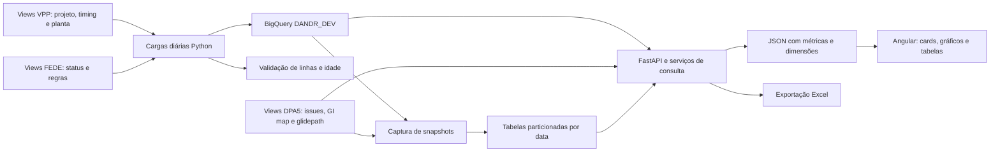

# Panorama de dados — D&R Dashboard

## 1. Qual versão e quais evidências

Backend: `fix/dpa5-program-filter-snapshot`, commit `6bcd7ae`, 31/08/2026. Frontend: `develop`, commit `f24ae41`, mesma data. [SOURCE-VERSIONS.json](SOURCE-VERSIONS.json) registra a importação. São as versões mais recentes disponíveis localmente: o acesso institucional suspenso impediu buscar commits posteriores.

**As queries BigQuery foram recuperadas.** A documentação inicial considerou a main local de 2025 e estava incompleta. Este documento a substitui. O panorama explica o código; os apêndices catalogam as funções, parâmetros, rotas e templates SQL com links para suas linhas. Não executamos queries na empresa, portanto resultados, custos, volumes e SLAs reais não foram medidos.

## 2. Fluxo completo



Há uma etapa de preparação dos dados e outra de consulta para apresentação. O Angular não acessa BigQuery diretamente. O backend executa SQL, converte resultados e entrega contratos HTTP. A linhagem comprovada começa nas views corporativas: o processo anterior de ingestão dessas views não está neste projeto.

Na demo, o fluxo é Angular → FastAPI local → registros sintéticos → agregações → JSON/Excel. As queries originais permanecem no repositório para estudo; não alimentam a demo.

## 3. Estrutura

| Caminho | Responsabilidade |
| --- | --- |
| `back/app/main.py` | Entrada da API mock, sem login ou BigQuery |
| `docs/original/backend_main.py` | Entrada original, routers e segurança Entra |
| `back/app/routes/` | Endpoints, parâmetros e delegação |
| `back/app/services/` | Queries, agregações, normalização e Excel |
| `back/app/services/bigquery_client.py` | Projetos, datasets e cliente BigQuery |
| `back/app/services/demo_service.py` | Registros sintéticos e cálculos da demo |
| `back/app/controllers/`, `schemas/`, `models/`, `core/` | Orquestração, contratos, modelos e configuração preservados |
| `back/scripts/` | Refresh, snapshots, verificação de schema e utilitários |
| `front/dandr-web/src/app/services/` | Clientes HTTP Angular |
| `front/dandr-web/src/app/dashboard/` | Telas, filtros e gráficos |
| `front/dandr-web/src/app/shared/state.service.ts` | Estado compartilhado entre telas e sidebar |
| `front/dandr-web/public/` | Imagens e fonte originais |
| `run-demo.sh` | Inicialização no Mac |

Código e estrutura recentes foram importados. Banco `.db`, planilhas/dumps com dados reais, credenciais, ambientes virtuais e histórico institucional ficaram fora. `requirements_install.txt` é o manifesto original; `requirements-demo.txt` atende a demonstração.

## 4. Como BigQuery funcionava

Projeto principal: `ford-ae4fa4b1aca14194fe8e5c19`, dataset `DANDR_DEV`. Projeto de views externas: `prj-dfad-1242-uapd-p-1242`. O helper `get_table_path()` resolve `project.dataset.table` por aliases. Há configuração BOM para `bq_284_fedebom_lc_vw`, mas o serviço recente de custos lê tabelas em DANDR_DEV.

O cliente original usa `bigquery.Client(project=PROJECT_ID)`, deixando a biblioteca resolver as credenciais do ambiente. Isso não prova qual conta de serviço/IAM estava efetivamente configurada. Autenticação Entra do usuário na API e credenciais Google do backend são mecanismos distintos.

Padrão de consulta: SQL + filtros → parâmetros em `QueryJobConfig` → `client.query()` → `.result()` ou `.to_dataframe()` → conversão de nulos, datas, números → JSON. Muitos métodos usam `ScalarQueryParameter`/`ArrayQueryParameter`; alguns, como a pesquisa Vehicle Line, interpolam texto. Não afirmar que todas as queries são parametrizadas.

Na cópia pessoal, `get_client()` bloqueia a nuvem por padrão. A entrada mock não importa os serviços BigQuery. Os scripts de refresh são material de estudo e não são executados por `run-demo.sh`.

## 5. Alimentação diária

`run_daily_refresh.py` documenta execução como Cloud Run Job acionado por Cloud Scheduler. O cron, fuso, configuração implantada e histórico real de execuções não estão nesses arquivos. O script roda oito jobs sequencialmente, registra log diário, continua após falhas para produzir um resumo e retorna código 1 se houver erro.

| Ordem | Script | Fonte | Destino em DANDR_DEV |
| --- | --- | --- | --- |
| 1 | `refresh_vehicle_line.py` | Views VPP 001, 005, 012 e 021 | `vehicle_line` |
| 2 | `refresh_fede_daily_status.py` | `bq_707_fedve_daily_lc_vw.fede_dv_status_vw` | `fede_daily_fedestatus` |
| 3 | `refresh_assessment.py` | `bq_707_fedve_daily_lc_vw.assessment_vw` | `fede_daily_assessmentvw` |
| 4 | `refresh_dr_design_rule.py` | `bq_707_fedve_daily_lc_vw.dr_design_rule_vw` | `dr_design_rule` |
| 5 | `refresh_dr_mapping.py` | `bq_707_fedve_daily_lc_vw.dr_mapping_vw` | `dr_mapping` |
| 6 | `refresh_dr_pk.py` | `bq_707_fedve_daily_lc_vw.pk_vw` | `fede_daily_pkvw` |
| 7 | `refresh_drassesmentvw.py` | `bq_707_fedve_daily_lc_vw.dr_assessment_vw` | `drassesmentvw` |
| 8 | `refresh_requirementvw.py` | `bq_707_fedve_daily_lc_vw.requirement_vw` | `fede_daily_requirementvw` |

Os oito usam **CREATE OR REPLACE TABLE AS SELECT**: recarga completa, não CDC/merge incremental. Sete copiam uma view com SELECT *. Vehicle Line consolida quatro fontes.

Vehicle Line faz FULL OUTER JOIN de `vpp001_glb_integrator_prj_vw` e `vpp005_prj_timing_pivot_vw` por `vpp001_gi_prj_id`. COALESCE aproveita metadados de ambos os lados; `b2.* EXCEPT(...)` mantém colunas restantes de timing. LEFT JOINs em Effective Point acrescentam plantCode/plantName via `vpp012_fedebom_decoder_vw` e WERS plant via `vpp021_wers_vpid_decoder_vw`. DISTINCT nos subselects não garante unicidade por chave; a cardinalidade precisa ser validada nos dados.

O refresh Vehicle Line compara schemas antes/depois e registra colunas adicionadas, removidas ou com tipo alterado. Ao fim, se nenhum job falhou, `verify_data_readiness.py` verifica acesso/existência, `num_rows > 0` e idade de `modified` ≤24h nas oito tabelas. Essa idade é do objeto BigQuery, não necessariamente do evento de negócio.

**Fronteira não resolvida:** as queries usam `dvp_fede`, `bom_piece_cost`, `bom_tooling_cost` e `fede_daily_drassesmentvw`, mas os oito jobs não criam essas tabelas. O refresh escreve `drassesmentvw`, enquanto HIR lê `fede_daily_drassesmentvw`. Pode haver transformação externa ou divergência de versão; não inventar o elo faltante.

## 6. Snapshots

`capture_weekly_snapshots.py` cria `dpa5_weekly_snapshot` e `dvp_weekly_snapshot`, particionadas por `snapshot_date`, e insere a data UTC de execução. O nome indica intenção semanal, mas a agenda efetiva não está comprovada.

DPA5 lê `dpa5_issue_list_field_raw_vw`, normaliza K-PAC com REGEXP_REPLACE/SPLIT/UNNEST, converte contagens com SAFE_CAST/COALESCE e agrega por **CPSC + lead_pmt + program + k_pac_id**. Conta dashboard_ids distintos e soma estados.

DVP lê `dvp_fede`, extrai ano de program, normaliza marco e estado e agrega por **GI + PMT + model_year + milestone_code**. Guarda Meet, Does Not Meet, Unassessed e total.

Os INSERTs não são precedidos de DELETE/MERGE: repetir o job no mesmo dia pode duplicar snapshots. Não há transação conjunta entre DPA5 e DVP; falha no segundo pode deixar o primeiro concluído. O handler imprime a exceção sem relançá-la.

Há uma divergência de contrato: o DDL do snapshot DVP é agregado, enquanto algumas queries de glidepath o selecionam como fonte esperando colunas detalhadas como program, sched_finish e conformance_state. É necessário conferir o schema real para comprovar esse caminho histórico.

## 7. Chaves, seletores e informações do cabeçalho

| Campo | Origem/papel |
| --- | --- |
| `gi_code` | `vpp001_gi_prj_id`, distribui o contexto do projeto |
| `program_code` | Na versão recente é `vpp001_gi_prj_ds`, descrição do projeto |
| `program_name` | `vpp001_gi_prod_pgm_ds` |
| `model_year` | `vpp001_veh_mdl_yr`; normalizado conforme a query |
| `effectivein` | Effective Point; filtro principal de custos |
| `cpsc` | Commodity |
| `pmt`/`pmt_code` | Sidebar 100…600; fontes podem usar 1…6 ou descrição com prefixo |
| `dvp_team` | Equipe de validação |
| `assessment_id`/`requirement_id` | Grãos diferentes: avaliação e requisito |
| `pk1`, `pk4`, `dr_pk2`, `dr_pk4_rec`, `pk_rec` | Chaves compostas usadas em parsing e joins |
| `milestone_date` | Data de marco, distinta de snapshot_date |

Home pesquisa `/search/model-years`, `/search/program-names` e `/search/program-codes`. Search chama `/vehicle-line/`. O serviço consulta vehicle_line, filtra, ordena e escolhe a primeira linha ou selected_index. Retorna GI, descrição, PTVL/código e descrição, programa, Effective Point, nameplate, ano, planta/WERS e marcos. `parseSummary()` também divide o texto por `|` e `:`. `StateService` propaga programa, GI, PMT, equipe, marco e painel ativo.

## 8. Pipeline de cada tela

### CAE Status

Endpoint `/fede-status/metrics/cae-total-assessments` → `get_cae_total_assessments` → `dvp_fede`. Filtra GI, prototype_type contendo CAE, estado não nulo/vazio, commodity ou programa e PMT. Agrupa por GI/programa. COUNT(*) é total; COUNTIF calcula Meet/Pass, Unassessed, Approved Deviation, Does Not Meet, Cannot Assess e Not Applicable. O Angular agrega grupos para cards/donut e divide categoria pelo total.

Há também consultas detalhadas e `/metrics/cae-graph`; os componentes legados não são necessariamente todos montados na tela principal. Use o template Home para identificar o ativo e o apêndice para os SQLs completos.

### DVP Assessment

`/fede-status/metrics/conf-state` chama `count_conf_state_results`; `/metrics/dvp-team-list` chama `get_metrics_by_dvp_team_list`. As queries contam estados por contexto e oferecem recortes GI, equipe, PMT e snapshot conforme o método. O serviço normaliza PMT numérico para aceitar código canônico e prefixo de origem. Assessment conta avaliações; não equivale automaticamente a requisitos únicos.

### DVP Classification

`/api/v1/fede-status/dvp-classification` → `get_dvp_classification_metrics` → `fede_daily_requirementvw`. Resolve programa pelo GI, limpa pontuação, usa slug dos três primeiros tokens e filtra o segmento inicial de pk1 e CPSC. Agrupa por requirement_id e usa MAX do indicador de classificação: uma ocorrência não nula diferente de Not Classified/Not Applicable torna o requisito classificado. Não classificados = total − classificados; percentual = classificados/total ×100. **snapshot_date é ignorado nessa função**, pois a tabela não possui essa coluna.

### DVP Glidepath

`/api/v1/dvp-glidepath/{pmts,milestones,data,snapshots}` usa `dvp_glidepath_service.py`. Filtra GI, PMT, marco e snapshot. Extrai ano de program e datas com SAFE_CAST: sched_finish, actual_end_date, milestone_date e demais marcos. O Angular constrói curvas de conclusão a partir de término planejado/real. A troca da fonte live para snapshot exige conferir a divergência de schema da seção 6. Há exportação própria de glidepath.

### Design Rules

Evidences: `/fede-status/metrics/dr-evidences-by-assessment` → `get_dr_evidences_by_assessment` → `dvp_fede`. Agrupa por GI, assessment, CPSC, ano e campos de marco; conta Meet/Pass, Does Not Meet e Unassessed. O denominador visual pode considerar somente essas três categorias.

Classification: `/fede-status/metrics/design-rule-classification` → `get_design_rule_classification` → `dr_design_rule`. Sem GI direto, extrai ano/programa de dr_pk2, normaliza espaços/underscores e tenta prefixos progressivamente menores. Conta Applicable, Carryover/Previously Validated, Not Applicable e Not Classified. A resposta informa matched_prefix. O fallback pode ampliar o conjunto; não é uma chave estrangeira garantida.

### HIR

`/api/v1/fede-status/hir-completion` → `get_hir_completion_metrics`. CTE base_dr lê `fede_daily_drassesmentvw`, filtra source HIR, converte dr_pk4_rec e normaliza has_evidence. CTE base_status lê `fede_daily_fedestatus` com DISTINCT, converte pk_rec, extrai programa de pk4 e aplica filtros. INNER JOIN une as chaves convertidas.

Agrupa programa/GI/marco/equipe/PMT/CPSC. With Evidence conta Y, Without Evidence conta N, Total conta todas as linhas; Completion = ROUND(SAFE_DIVIDE(count Y,total)*100,1). Outros valores podem entrar no denominador sem entrar em Y/N. Cardinalidade do join deve ser validada para evitar duplicação.

### DPA5

`/dpa5/summary` → `get_dpa5_summary` → `get_dpa5_data`. Fontes externas no dataset `bq_666_dpa5_lc_vw`: `dpa5_issue_list_field_raw_vw`, `dpa5_glidepath_date_raw_vw`, `dpa5_dashboard_id_gp_id_raw_vw`.

Primeiro resolve dashboard_ids pelo GI map. Sem correspondência, usa CPSC informada ou CPSCs do GI em dvp_fede. Resolve programas-base e aplica filtro de programa em suas estratégias; sem base pode usar AND 1=0. PMT 200 vira prefixo `2 -%` de lead_pmt. K-PAC é separado/normalizado antes de agregações e associação a metas.

O resumo soma as categorias dos registros; a composição exata de not assessable consta em get_dpa5_summary. As metas são agrupadas por data e frações podem virar percentuais. Sem marcos do join embutido, há fallback via CPSCs. O código reutiliza totais atuais nas datas passadas e zera datas futuras: isso **não é um histórico observado completo**. compliance_prediction pode ser None; não existe evidência de um modelo de machine learning.

### Costs

`/cost/metrics/{piece,tooling,combined}` usa `cost_service.py`, lendo `DANDR_DEV.bom_piece_cost` e `bom_tooling_cost`. O preenchimento dessas tabelas não está nos oito refreshs. Filtros: effectivein, effectiveout vazio/nulo, CPSC, peça/PMT conforme método; custo real deve ser positivo. `resolve_pmt` converte 100…600 em 1…6.

Campos: peça, programa, vehicleline, commodity/nome, real/meta, moeda, gap e referência; tooling também planta/funding source. Gap = real − meta. Backend soma os custos; Angular agrupa por commodity e peça e produz tabela expansível. `/cost/dropdowns` reúne seletores; combined reúne totais. Tooling e custo unitário têm naturezas diferentes: o card combinado não comprova custo industrial total sem volume e moeda normalizados.

### Milestone Readiness

`/api/v1/milestone-readiness/{gi}` consulta `vehicle_line`, valida marco e executa três queries em paralelo: DVP, CAE e Design Rules. DVP/CAE recortam avaliações devidas até a data, distinguem CAE por prototype_type e contam concluídas conforme `_COMPLETED_STATES`.

Design Rules não filtra data: no SQL, Target = Applicable + Carryover + Previously Validated; Actual = Carryover + Previously Validated. O comentário da função difere do SQL; a query é a referência da implementação. Percentual = actual/target ×100, zero com target zero. Green ≥100%, Yellow ≥80%, Red abaixo disso. Falhas são registradas por fonte; zero e erro não são equivalentes.

## 9. Excel

`export_routes.py` delega para `excel_export_service.py`: CAE, DVP, DVP Glidepath, HIR, Design Rules, DPA5 e custos possuem queries próprias, incluídas no apêndice. Exportar não significa necessariamente baixar somente as linhas visíveis. O frontend pede blob e cria uma URL temporária de download.

Na demo, o arquivo contém registros sintéticos filtrados e uma aba About; não replica todos os templates corporativos. Os serviços originais de Excel permanecem para estudo.

## 10. Pontos de atenção para a entrevista

- A linhagem anterior às views e alguns objetos derivados não são definidos nesta base. Não inventar essa ingestão.
- Refresh completo não é incremental, e o conjunto de oito tabelas não é atualizado atomicamente.
- Os snapshots não são idempotentes e o DVP apresenta diferença de schema entre produtor e consumidor.
- `get_dpa5_snapshots` aparece duas vezes: a última definição prevalece e lista datas sem filtrar GI, apesar do parâmetro.
- Algumas queries retornam vazio em caso de exceção; outras propagam. Tela vazia pode esconder erro.
- A validação de modified mede atualização da tabela, não completude/frescor de todos os eventos.
- Não há evidência suficiente para afirmar clustering universal, volumes, custos, cron implantado ou SLA medido.
- O original combina normalização de PMT, parsing de chaves, COUNTIF, SAFE_CAST, SAFE_DIVIDE, UNNEST, agregação por grão e API tipada: estes são pontos demonstráveis no código.

## 11. Roteiro de apresentação

“O projeto separa preparação diária e consulta de indicadores. Views corporativas eram materializadas em tabelas de consumo no BigQuery. Os serviços Python aplicavam filtros e agregações e entregavam JSON/Excel. O Angular coordenava programa, PMT, commodity, equipe e snapshot. Esta cópia mantém a estrutura e as queries, com dados sintéticos para apresentar.”

Mostre Vehicle Line/GI → CAE com mudança de PMT → DVP/snapshot → custos por commodity → Excel → query e refresh da fonte. Diferencie o que o código prova da sua experiência pessoal e dos dados indisponíveis. Os mocks não são validação de equivalência das queries corporativas.

## 12. Rodar no Mac

### Neste Mac, na cópia já preparada

Abra o Terminal e cole:

```bash
cd "/Users/gabrielaragao/Documents/Codex/2026-09-08/eu-perdi-acesso-ao-meu-computador/outputs/engineering-demo"
./run-demo.sh
```

Espere aparecer `Dashboard: http://localhost:4200`, mantenha o terminal aberto e acesse **http://localhost:4200**. A API fica em **http://localhost:8000/docs**. Encerre com **Control+C**.

Pesquise ano **2026**, código **AU-01**, programa **Aurora EV** e clique Search. Em Costs, selecione PMT **100**. Outro programa: **OR-02 / Orion Hybrid**.

### Clone novo ou outro Mac

Requisitos: Python 3.11+, Node.js 22.12+ e pnpm 11 (`npm install -g pnpm@11`). Faça login no GitHub pessoal se o repositório for privado.

```bash
git clone https://github.com/gabrielfrz/ford-mockado.git
cd ford-mockado
./run-demo.sh
```

A primeira instalação precisa de internet. O script cria back/.venv, instala dependências mock, compila Angular e sobe os dois serviços. Neste Mac também pode usar o runtime do Codex. Não é necessário gcloud, BigQuery, banco ou login institucional.

### Desenvolvimento com recarga

Depois da instalação inicial, use dois terminais na raiz, sem run-demo.sh simultâneo:

```bash
# Terminal 1
back/.venv/bin/python -m uvicorn app.main:app --app-dir back --host 127.0.0.1 --port 8000 --reload
```

```bash
# Terminal 2, Node/pnpm no PATH
cd front/dandr-web
pnpm start --host 127.0.0.1
```

### Verificação

```bash
curl http://localhost:8000/health
# Deve indicar data_source synthetic
cd back
.venv/bin/python -m unittest discover -s tests -p test_demo.py -v
```

Os testes originais dependem do ambiente de produção; o comando seleciona os da demo. Se uma porta estiver ocupada, encerre a execução anterior com Control+C. Se node/pnpm estiverem ausentes, instale os requisitos. Se mover .venv/node_modules entre pastas, recrie essas dependências; prefira clone limpo. Se uma tela falhar, confira /health e o terminal da API. Não execute scripts de refresh para iniciar a demonstração.

# Apêndice A — funções, filtros e rotas

## [back/app/controllers/summary_controller.py](../back/app/controllers/summary_controller.py)

| Função | Parâmetros | Decoradores/rota |
| --- | --- | --- |
| [summary_controller](../back/app/controllers/summary_controller.py#L5) | `model_year: float, program_names: str, program_codes: str, selected_index: int \| None=None` | `` |

## [back/app/controllers/vehicle_line_controller.py](../back/app/controllers/vehicle_line_controller.py)

| Função | Parâmetros | Decoradores/rota |
| --- | --- | --- |
| [fetch_vehicle_line_summary](../back/app/controllers/vehicle_line_controller.py#L5) | `program_code: str, model_year: int, program_name: str` | `` |

## [back/app/core/auth.py](../back/app/core/auth.py)

| Função | Parâmetros | Decoradores/rota |
| --- | --- | --- |
| [_jwks_client](../back/app/core/auth.py#L48) | `jwks_uri: str` | `lru_cache(maxsize=4)` |
| [_token_version](../back/app/core/auth.py#L58) | `token: str, auth_settings: Settings` | `` |
| [validate_access_token](../back/app/core/auth.py#L77) | `token: str, *, auth_settings: Settings=settings, signing_key: Any \| None=None` | `` |
| [require_authenticated_user](../back/app/core/auth.py#L146) | `request: Request, credentials: HTTPAuthorizationCredentials \| None=Security(bearer_scheme)` | `` |

## [back/app/core/config.py](../back/app/core/config.py)

| Função | Parâmetros | Decoradores/rota |
| --- | --- | --- |
| [_csv_environment](../back/app/core/config.py#L16) | `name: str, default: str` | `` |
| [_validate_uuid](../back/app/core/config.py#L24) | `name: str, value: str` | `` |
| [from_environment](../back/app/core/config.py#L46) | `cls` | `classmethod` |
| [issuer](../back/app/core/config.py#L93) | `self, token_version: str` | `` |
| [jwks_uri](../back/app/core/config.py#L102) | `self, token_version: str` | `` |
| [audiences](../back/app/core/config.py#L107) | `self, token_version: str` | `` |

## [back/app/core/data_loader.py](../back/app/core/data_loader.py)

| Função | Parâmetros | Decoradores/rota |
| --- | --- | --- |
| [load_vehicle_data](../back/app/core/data_loader.py#L6) | `path: str='data/merge.xlsx'` | `` |

## [back/app/main.py](../back/app/main.py)

| Função | Parâmetros | Decoradores/rota |
| --- | --- | --- |
| [health](../back/app/main.py#L12) | `` | `app.get('/health')` |

## [back/app/openapi.py](../back/app/openapi.py)

| Função | Parâmetros | Decoradores/rota |
| --- | --- | --- |
| [get_openapi_contact](../back/app/openapi.py#L95) | `` | `` |
| [get_openapi_servers](../back/app/openapi.py#L107) | `` | `` |
| [generate_operation_id](../back/app/openapi.py#L131) | `route: APIRoute` | `` |
| [_convert_nullable_schemas](../back/app/openapi.py#L138) | `value: Any` | `` |
| [_bounded_string_pattern](../back/app/openapi.py#L172) | `min_length: int, max_length: int` | `` |
| [_string_schema](../back/app/openapi.py#L176) | `*, min_length: int=0, max_length: int=256` | `` |
| [_integer_schema](../back/app/openapi.py#L185) | `*, minimum: int=0, maximum: int=2147483647` | `` |
| [_number_schema](../back/app/openapi.py#L194) | `*, minimum: float=-1000000000000.0, maximum: float=1000000000000.0` | `` |
| [_array_schema](../back/app/openapi.py#L203) | `items: dict[str, Any], *, max_items: int=10000` | `` |
| [_object_schema](../back/app/openapi.py#L211) | `properties: dict[str, Any], *, required: tuple[str, ...]=()` | `` |
| [_row_array](../back/app/openapi.py#L227) | `` | `` |
| [_string_array](../back/app/openapi.py#L231) | `` | `` |
| [_success_response_schemas](../back/app/openapi.py#L235) | `` | `` |
| [_add_common_components](../back/app/openapi.py#L398) | `schema: dict[str, Any]` | `` |
| [_parameter_example](../back/app/openapi.py#L482) | `parameter: dict[str, Any]` | `` |
| [_harden_schema](../back/app/openapi.py#L521) | `value: Any` | `` |
| [_harden_operations](../back/app/openapi.py#L554) | `schema: dict[str, Any]` | `` |
| [_harden_openapi_schema](../back/app/openapi.py#L635) | `schema: dict[str, Any]` | `` |
| [configure_openapi_compatibility](../back/app/openapi.py#L642) | `app: FastAPI` | `` |
| [custom_openapi](../back/app/openapi.py#L646) | `` | `` |

## [back/app/routes/cost_routes.py](../back/app/routes/cost_routes.py)

| Função | Parâmetros | Decoradores/rota |
| --- | --- | --- |
| [list_cpsc_by_effective_point](../back/app/routes/cost_routes.py#L21) | `effectivein: str=Query(..., description='Effective Point code (for example, S4PVBS)')` | `router.get('/cpsc/list', summary='List CPSCs by Effective Point')` |
| [autocomplete_cpsc](../back/app/routes/cost_routes.py#L40) | `effectivein: str=Query(..., description='Effective Point code (for example, S4PVBS)'), q: str=Query('', description='Case-insensitive CPSC search term')` | `router.get('/cpsc/autocomplete', summary='Autocomplete CPSC by Effective Point')` |
| [list_pmt_by_effective_point](../back/app/routes/cost_routes.py#L71) | `effectivein: str=Query(..., description='Effective Point code (for example, S4PVBS)'), cpsc: str=Query(None, description='Optional CPSC filter')` | `router.get('/pmt/list', summary='List PMTs by Effective Point')` |
| [get_dropdowns](../back/app/routes/cost_routes.py#L92) | `effectivein: str=Query(..., description='Effective Point code (for example, VBS)')` | `router.get('/dropdowns', summary='Load all cost dropdowns in one query')` |
| [list_partnumbers](../back/app/routes/cost_routes.py#L112) | `effectivein: str=Query(..., description='Effective Point code (for example, VBS)'), q: str=Query(None, description='Optional case-insensitive part-number search')` | `router.get('/partnumber/list', summary='List part numbers')` |
| [list_commodities](../back/app/routes/cost_routes.py#L133) | `effectivein: str=Query(..., description='Effective Point code (for example, VBS)'), q: str=Query(None, description='Optional commodity code or name search')` | `router.get('/commodity/list', summary='List commodities')` |
| [list_vehiclelines](../back/app/routes/cost_routes.py#L154) | `effectivein: str=Query(..., description='Effective Point code (for example, VBS)'), q: str=Query(None, description='Optional vehicle-line search')` | `router.get('/vehicleline/list', summary='List vehicle lines')` |
| [get_tooling_metrics](../back/app/routes/cost_routes.py#L175) | `effectivein: str=Query(..., description='Effective Point code (for example, VBS)'), cpsc: str=Query(None, description='Optional CPSC filter'), pmt_code: str=Query(None, description='Optional PMT filter')` | `router.get('/metrics/tooling', summary='Tooling cost metrics')` |
| [get_piece_metrics](../back/app/routes/cost_routes.py#L201) | `effectivein: str=Query(..., description='Effective Point code (for example, VBS)'), partnumber: str=Query(None, description='Optional part-number filter'), cpsc: str=Query(None, description='Optional CPSC filter'), pmt_code: str=Query(None, description='Optional PMT filter')` | `router.get('/metrics/piece', summary='Piece cost metrics')` |
| [get_combined_metrics](../back/app/routes/cost_routes.py#L234) | `effectivein: str=Query(..., description='Effective Point code (for example, S4PVBS)'), cpsc: str=Query(None, description='Optional CPSC filter'), pmt_code: str=Query(None, description='Optional PMT filter')` | `router.get('/metrics/combined', summary='Combined cost metrics')` |

## [back/app/routes/dpa5_routes.py](../back/app/routes/dpa5_routes.py)

| Função | Parâmetros | Decoradores/rota |
| --- | --- | --- |
| [get_dpa5](../back/app/routes/dpa5_routes.py#L17) | `gi_code: str=Query(..., description='GI Code from vehicle_line'), cpsc: str=Query(None, description='Single CPSC code filter (optional)'), page: int=Query(1, description='Page number (1-based)', ge=1), limit: int=Query(100, description='Records per page (max 500)', ge=1, le=500), snapshot_date: str=Query(None, description='Date for historical snapshot (optional)')` | `router.get('/data', summary='DPA5 K-PAC Data', description='Returns DPA5 K-PAC aggregated data with glidepath milestones, filtered by the CPSC codes associated with the given GI Code.')` |
| [get_dpa5_summary_route](../back/app/routes/dpa5_routes.py#L57) | `gi_code: str=Query(..., description='GI Code from vehicle_line'), cpsc: str=Query(None, description='Single CPSC code filter (optional)'), pmt: str=Query(None, description="PMT code filter e.g. '200' (optional)"), snapshot_date: str=Query(None, description='Date for historical snapshot (optional)')` | `router.get('/summary', summary='DPA5 Summary + Glidepath', description='Returns DPA5 aggregated totals (for donut chart) and glidepath goal curves per milestone date (for the glidepath chart).')` |
| [get_dpa5_cpsc_list_route](../back/app/routes/dpa5_routes.py#L71) | `gi_code: str=Query(..., description='GI Code from vehicle_line'), pmt: str=Query(None, description="PMT code filter e.g. '200' (optional)")` | `router.get('/cpsc-list', summary='DPA5 CPSC List')` |
| [get_dpa5_snapshots_route](../back/app/routes/dpa5_routes.py#L84) | `gi_code: str=Query(..., description='GI Code from vehicle_line')` | `router.get('/snapshots', summary='DPA5 Available Snapshots')` |

## [back/app/routes/dvp_glidepath_routes.py](../back/app/routes/dvp_glidepath_routes.py)

| Função | Parâmetros | Decoradores/rota |
| --- | --- | --- |
| [get_glidepath_data](../back/app/routes/dvp_glidepath_routes.py#L23) | `gi_code: str=Query(..., description='Vehicle-line GI code (for example, GI-10001)'), pmt: str=Query(None, description='Optional PMT filter (for example, 200)'), milestone: str=Query(None, description='Optional milestone date in YYYY-MM-DD format')` | `router.get('/data', summary='DVP Glidepath Data', description='Return DVP glidepath data aggregated by GI code, model year, and date. The response includes compliance metrics and milestone, scheduled-finish, and actual-finish timelines.')` |
| [list_available_pmts](../back/app/routes/dvp_glidepath_routes.py#L42) | `gi_code: str=Query(..., description='Vehicle-line GI code in GI-xxxxx format')` | `router.get('/pmts', summary='Available PMTs', description='Return distinct PMT codes available for a GI code.')` |
| [list_available_milestones](../back/app/routes/dvp_glidepath_routes.py#L62) | `gi_code: str=Query(..., description='Vehicle-line GI code in GI-xxxxx format'), pmt: str=Query(None, description='Optional PMT filter (for example, 200)')` | `router.get('/milestones', summary='Available milestones', description='Return distinct milestones for a GI code, optionally filtered by PMT.')` |
| [list_available_snapshots](../back/app/routes/dvp_glidepath_routes.py#L83) | `gi_code: str=Query(..., description='GI Code do vehicle_line')` | `router.get('/snapshots', summary='Snapshots Disponíveis', description='Retorna lista de snapshots disponíveis')` |

## [back/app/routes/effective_point_routes.py](../back/app/routes/effective_point_routes.py)

| Função | Parâmetros | Decoradores/rota |
| --- | --- | --- |
| [get_all_effective_points](../back/app/routes/effective_point_routes.py#L14) | `` | `router.get('/')` |
| [check_effective_point_exists](../back/app/routes/effective_point_routes.py#L19) | `code: str` | `router.get('/search/')` |

## [back/app/routes/export_routes.py](../back/app/routes/export_routes.py)

| Função | Parâmetros | Decoradores/rota |
| --- | --- | --- |
| [export_cae_status_endpoint](../back/app/routes/export_routes.py#L21) | `gi_id: str=Query(..., description='GI ID for filtering CAE status records'), pmt_code: str=Query(None, description='Optional PMT code')` | `router.get('/cae-status', summary='Export CAE Status to Excel', description='Export CAE assessment data for a specific GI Code as professional Excel file')` |
| [export_dvp_team_assessment_endpoint](../back/app/routes/export_routes.py#L71) | `gi_id: str=Query(..., description='GI ID for filtering DVP Team assessment records'), dvp_team: str=Query(None, description='Optional DVP Team name to filter (if not provided, exports all teams)'), snapshot_date: str=Query(None, description='Optional Snapshot date filter')` | `router.get('/dvp-team-assessment', summary='Export DVP Team Assessment to Excel', description='Export DVP Team assessment data for a specific GI Code as professional Excel file')` |
| [export_design_rule_endpoint](../back/app/routes/export_routes.py#L122) | `model_year: str=Query(..., description='Model year (e.g. 2027)'), program_name: str=Query(..., description="Program name used to locate Design Rule records (e.g. 'U725 Special Mackinaw tophat')"), pmt_code: str=Query(None, description='Optional PMT code')` | `router.get('/design-rule', summary='Export Design Rule Classification to Excel', description='Export Design Rule classification data for a specific model year and program as a professional Excel file')` |
| [export_dpa5_endpoint](../back/app/routes/export_routes.py#L169) | `gi_code: str=Query(..., description='GI Code from vehicle_line'), cpsc: str=Query(None, description='Single CPSC code filter (optional)'), pmt: str=Query(None, description="PMT code filter e.g. '200' (optional)"), snapshot_date: str=Query(None, description='Snapshot date filter (optional)')` | `router.get('/dpa5', summary='Export DPA5 K-PAC Data to Excel', description='Export DPA5 K-PAC aggregated data for a specific GI Code as professional Excel file')` |
| [export_dvp_glidepath](../back/app/routes/export_routes.py#L218) | `gi_code: str=Query(..., description='GI Code from vehicle_line. Example: GI-10199'), pmt: str=Query(None, description='Optional PMT Code filter. Example: 200'), milestone: str=Query(None, description='Optional Milestone filter. Format: YYYY-MM-DD'), snapshot_date: str=Query(None, description='Optional Snapshot date filter')` | `router.get('/dvp-glidepath', summary='Export DVP Glidepath Excel', description='Export DVP Glidepath consolidated data to Excel, with optional filters by PMT and Milestone.')` |
| [export_hir_endpoint](../back/app/routes/export_routes.py#L278) | `gi_code: str=Query(..., description='GI Code from vehicle_line'), cpsc: str=Query(None, description='CPSC code filter (optional)'), pmt_code: str=Query(None, description='PMT code filter (optional)'), milestone_date: str=Query(None, description='Milestone date filter (optional, format YYYY-MM-DD)')` | `router.get('/hir', summary='Export HIR Completion to Excel', description='Export HIR (Hardware in Review) completion data for a specific GI Code as professional Excel file')` |
| [export_costs_endpoint](../back/app/routes/export_routes.py#L339) | `effectivein: str=Query(..., description='Effective Point code (e.g. S4PVBS)'), cpsc: str=Query(None, description='CPSC code filter (optional)'), pmt_code: str=Query(None, description='PMT code filter (optional)'), cost_type: str=Query('both', description="Cost type: 'tooling', 'piece', or 'both' (default: both)")` | `router.get('/costs', summary='Export Costs to Excel', description='Export Tooling and Piece Cost data for a specific Effective Point as professional Excel file with two sheets')` |

## [back/app/routes/fede_status_routes.py](../back/app/routes/fede_status_routes.py)

| Função | Parâmetros | Decoradores/rota |
| --- | --- | --- |
| [dvp_classification](../back/app/routes/fede_status_routes.py#L28) | `gi_code: str=Query(..., description='GI Code do vehicle_line'), cpsc: str=Query(..., description='Commodity CPSC'), snapshot_date: str=Query(None, description='Snapshot date opcional')` | `router_v1.get('/dvp-classification', summary='DVP classification metrics', description='Return total, classified, unclassified, and percentage values for a GI code and CPSC.')` |
| [autocomplete_dvp_teams](../back/app/routes/fede_status_routes.py#L42) | `gi_code: str=Query(..., description='Vehicle-line GI code'), q: str=Query('', description='DVP team search term'), pmt_code: str=Query(None, description='Optional PMT code')` | `router.get('/dvp-teams/autocomplete', summary='Autocomplete DVP teams by GI code', description='Return DVP team suggestions filtered by GI code.')` |
| [autocomplete_dvp_teams_by_gi_code](../back/app/routes/fede_status_routes.py#L71) | `gi_code: str=Query(..., description='Vehicle-line GI code'), q: str=Query('', description='DVP team search term'), pmt_code: str=Query(None, description='Optional PMT code')` | `router.get('/dvp-teams/autocomplete/by-gi-code', summary='Autocomplete DVP teams by GI code', description='Return DVP team suggestions for a specific GI code.')` |
| [list_cpsc_by_gi_code](../back/app/routes/fede_status_routes.py#L110) | `gi_code: str=Query(..., description='Vehicle-line GI code'), pmt_code: str=Query(None, description='Optional PMT code')` | `router.get('/cpsc/list', summary='List CPSCs by GI code', description='Return all distinct CPSC codes for the supplied GI code.')` |
| [autocomplete_cpsc](../back/app/routes/fede_status_routes.py#L136) | `gi_code: str=Query(..., description='Vehicle-line GI code'), q: str=Query('', description='CPSC search term'), pmt_code: str=Query(None, description='Optional PMT code')` | `router.get('/cpsc/autocomplete', summary='Autocomplete CPSCs by GI code', description='Return CPSC suggestions filtered by GI code and search term.')` |
| [get_metrics_by_dvp_team_list_endpoint](../back/app/routes/fede_status_routes.py#L174) | `gi_code: str=Query(..., description='GI Code do vehicle_line'), snapshot_date: str=Query(None, description='Snapshot date opcional')` | `router.get('/metrics/dvp-team-list', summary='Métricas por DVP Team - Lista Completa', description='Retorna métricas de conf_state agrupadas por cada DVP Team do gi_code')` |
| [get_total_assessments](../back/app/routes/fede_status_routes.py#L208) | `gi_code: str=Query(None, description='Optional GI code filter')` | `router.get('/metrics/total-assessments', summary='Total assessment metrics', description='Return the total assessment count.')` |
| [get_conf_state_metrics](../back/app/routes/fede_status_routes.py#L230) | `gi_code: str=Query(None, description='GI Code para filtrar (opcional)'), snapshot_date: str=Query(None, description='Snapshot date opcional')` | `router.get('/metrics/conf-state', summary='Métricas - Conf State', description='Retorna contagens agrupadas por estado de conformidade')` |
| [get_assessment_dvp_status](../back/app/routes/fede_status_routes.py#L261) | `gi_code: str=Query(..., description='Vehicle-line GI code')` | `router.get('/metrics/assessment-dvp-status', summary='DVP assessment CPSC distribution', description='Return DVP assessment conformance states grouped by CPSC.')` |
| [get_design_rules_evidences](../back/app/routes/fede_status_routes.py#L291) | `gi_code: str=Query(..., description='Vehicle-line GI code')` | `router.get('/metrics/design-rules-evidences', summary='Design Rule evidence metrics', description='Return Design Rule evidence metrics grouped by milestone and model year.')` |
| [get_assessment_milestone](../back/app/routes/fede_status_routes.py#L324) | `gi_code: str=Query(..., description='Vehicle-line GI code'), cpsc: str=Query(None, description='Optional CPSC filter'), pmt_code: str=Query(None, description='Optional PMT code')` | `router.get('/metrics/dr-evidences-by-assessment', summary='DR evidence metrics by assessment', description='Return DR evidence metrics grouped by assessment and milestone, with an optional CPSC filter.')` |
| [get_cae_graph](../back/app/routes/fede_status_routes.py#L365) | `gi_code: str=Query(..., description='Vehicle-line GI code')` | `router.get('/metrics/cae-graph', summary='CAE chart metrics', description='Return CAE data grouped by CPSC and assessment ID.')` |
| [get_design_rule_classification_endpoint](../back/app/routes/fede_status_routes.py#L396) | `model_year: str=Query(..., description='Model year (e.g. 2027)'), program_name: str=Query(..., description='Program name (e.g. U725_Special_Mackinaw)'), pmt_code: str=Query(None, description='Optional PMT code')` | `router.get('/metrics/design-rule-classification', summary='Design Rule Classification - Distribution by Model Year and Program', description='Returns distribution of Design Rule classifications grouped by model year and program name')` |
| [get_cae_total](../back/app/routes/fede_status_routes.py#L428) | `gi_code: str=Query(..., description='GI Code from vehicle_line'), program: str=Query(None, description='Program name filter (optional, legacy)'), cpsc: str=Query(None, description='CPSC code filter from dvp_team (optional)'), pmt_code: str=Query(None, description='Optional PMT code')` | `router.get('/metrics/cae-total-assessments', summary='CAE Total Assessments', description='Returns total CAE assessment counts grouped by program')` |
| [get_cae_detailed](../back/app/routes/fede_status_routes.py#L446) | `gi_code: str=Query(..., description='Vehicle-line GI code'), program: str=Query(None, description='Optional program name')` | `router.get('/metrics/cae-detailed', summary='CAE detailed records', description='Return row-level CAE records grouped by CPSC and assessment name.')` |
| [hir_completion](../back/app/routes/fede_status_routes.py#L474) | `gi_code: str=Query(..., description='Vehicle-line GI code'), cpsc: str=Query(None, description='Optional commodity CPSC code'), pmt_code: str=Query(None, description='Optional PMT code'), milestone_date: str=Query(None, description='Optional milestone date'), dvp_team: str=Query(None, description='Optional DVP team')` | `router_v1.get('/hir-completion', summary='HIR completion metrics', description='Return Hardware in Review completion metrics with optional filters.')` |

## [back/app/routes/key_datas_routes.py](../back/app/routes/key_datas_routes.py)

| Função | Parâmetros | Decoradores/rota |
| --- | --- | --- |
| [get_db](../back/app/routes/key_datas_routes.py#L10) | `` | `` |
| [list_key_datas](../back/app/routes/key_datas_routes.py#L18) | `effective_point_id: int=None, db: Session=Depends(get_db)` | `router.get('/', response_model=List[KeyDataSchema])` |

## [back/app/routes/milestone_readiness_routes.py](../back/app/routes/milestone_readiness_routes.py)

| Função | Parâmetros | Decoradores/rota |
| --- | --- | --- |
| [milestone_readiness](../back/app/routes/milestone_readiness_routes.py#L20) | `gi_code: str=Path(..., description='Vehicle-line GI code (for example, VF123456)'), milestone: str=Query(..., description=f"Milestone key matching a vehicle-line table column. Accepted values: {', '.join(VALID_MILESTONES)}"), pmt_code: str=Query(None, description='Optional PMT code')` | `router.get('/milestone-readiness/{gi_code}', summary='Milestone Readiness', description='Calculate milestone readiness for a GI code by aggregating DVP, CAE, and Design Rule metrics in parallel.')` |

## [back/app/routes/pmt_routes.py](../back/app/routes/pmt_routes.py)

| Função | Parâmetros | Decoradores/rota |
| --- | --- | --- |
| [resolve_pmt](../back/app/routes/pmt_routes.py#L21) | `pmt_display: str, module: str` | `` |
| [list_pmt_codes](../back/app/routes/pmt_routes.py#L27) | `` | `router.get('/list', summary='List canonical PMT codes')` |

## [back/app/routes/summary_routes.py](../back/app/routes/summary_routes.py)

| Função | Parâmetros | Decoradores/rota |
| --- | --- | --- |
| [get_summary](../back/app/routes/summary_routes.py#L10) | `program_code: str=Query(...), model_year: int=Query(...), program_name: str=Query(...)` | `router.get('/', response_model=SummarySchema)` |

## [back/app/routes/system_routes.py](../back/app/routes/system_routes.py)

| Função | Parâmetros | Decoradores/rota |
| --- | --- | --- |
| [test_api_availability](../back/app/routes/system_routes.py#L24) | `` | `router.get('/test', response_model=HealthResponse, responses={200: {'description': 'OK'}}, summary='Test API availability', description='Returns HTTP 200 when the API is available.')` |

## [back/app/routes/vehicle_line_routes.py](../back/app/routes/vehicle_line_routes.py)

| Função | Parâmetros | Decoradores/rota |
| --- | --- | --- |
| [vehicle_line_summary](../back/app/routes/vehicle_line_routes.py#L19) | `model_year: float=Query(..., description='Model year (for example, 2027)'), program_codes: str=Query(..., description='Project description (for example, U725 Special "Mackinaw" tophat)'), program_names: str=Query('', description='Optional vehicle or program name filter (for example, Bronco)'), selected_index: int \| None=Query(None, description='Row index to select when multiple options exist (for example, 0)')` | `router.get('/vehicle-line/', tags=['Vehicle Line'], response_model=VehicleLineSchema)` |
| [search_model_years](../back/app/routes/vehicle_line_routes.py#L66) | `query: str=Query('', description='Model-year search term')` | `router.get('/search/model-years', tags=['Vehicle Line'])` |
| [search_program_names](../back/app/routes/vehicle_line_routes.py#L85) | `model_year: str=Query('', description='Selected model year'), query: str=Query('', description='Program-name search term')` | `router.get('/search/program-names', tags=['Vehicle Line'])` |
| [search_program_codes](../back/app/routes/vehicle_line_routes.py#L109) | `model_year: str=Query('', description='Selected model year'), program_name: str=Query('', description='Selected program name'), query: str=Query('', description='Project-description search term')` | `router.get('/search/program-codes', tags=['Vehicle Line'])` |

## [back/app/services/bigquery_client.py](../back/app/services/bigquery_client.py)

| Função | Parâmetros | Decoradores/rota |
| --- | --- | --- |
| [get_client](../back/app/services/bigquery_client.py#L40) | `` | `` |
| [get_table_path](../back/app/services/bigquery_client.py#L49) | `dataset_key: str, table_name: str` | `` |
| [get_dataset_name](../back/app/services/bigquery_client.py#L69) | `dataset_key: str` | `` |
| [get_dataset_project](../back/app/services/bigquery_client.py#L77) | `dataset_key: str` | `` |

## [back/app/services/cost_service.py](../back/app/services/cost_service.py)

| Função | Parâmetros | Decoradores/rota |
| --- | --- | --- |
| [get_cpsc_by_effective_point](../back/app/services/cost_service.py#L12) | `effectivein: str` | `` |
| [autocomplete_cpsc_by_effective_point](../back/app/services/cost_service.py#L37) | `effectivein: str, query: str=''` | `` |
| [get_pmt_by_effective_point](../back/app/services/cost_service.py#L68) | `effectivein: str, cpsc: str=None` | `` |
| [get_partnumber_list](../back/app/services/cost_service.py#L97) | `effectivein: str, q: str=None` | `` |
| [get_commodity_list](../back/app/services/cost_service.py#L132) | `effectivein: str, q: str=None` | `` |
| [get_vehicleline_list](../back/app/services/cost_service.py#L176) | `effectivein: str, q: str=None` | `` |
| [get_dropdown_data](../back/app/services/cost_service.py#L211) | `effectivein: str` | `` |
| [get_tooling_cost_metrics](../back/app/services/cost_service.py#L262) | `effectivein: str, cpsc: str=None, pmt_code: str=None` | `` |
| [_safe_float](../back/app/services/cost_service.py#L325) | `val` | `` |
| [get_piece_cost_metrics](../back/app/services/cost_service.py#L365) | `effectivein: str, partnumber: str=None, cpsc: str=None, pmt_code: str=None` | `` |
| [_safe_float](../back/app/services/cost_service.py#L436) | `val` | `` |
| [get_combined_cost_metrics](../back/app/services/cost_service.py#L481) | `effectivein: str, cpsc: str=None, pmt_code: str=None` | `` |

## [back/app/services/dpa5_service.py](../back/app/services/dpa5_service.py)

| Função | Parâmetros | Decoradores/rota |
| --- | --- | --- |
| [_safe_int](../back/app/services/dpa5_service.py#L16) | `val` | `` |
| [_safe_str](../back/app/services/dpa5_service.py#L29) | `val` | `` |
| [get_dpa5_snapshots](../back/app/services/dpa5_service.py#L33) | `gi_code: str` | `` |
| [_get_cpscs_for_gi_code](../back/app/services/dpa5_service.py#L42) | `client, gi_code: str` | `` |
| [_get_base_programs_for_gi_code](../back/app/services/dpa5_service.py#L62) | `client, gi_code: str` | `` |
| [get_dpa5_cpsc_list](../back/app/services/dpa5_service.py#L88) | `gi_code: str, pmt_filter: str \| None=None` | `` |
| [get_dpa5_data](../back/app/services/dpa5_service.py#L161) | `gi_code: str, cpsc_filter: str \| None=None, pmt_filter: str \| None=None, snapshot_date: str \| None=None` | `` |
| [_get_glidepath_via_cpscs](../back/app/services/dpa5_service.py#L491) | `client, gi_code: str` | `` |
| [get_dpa5_summary](../back/app/services/dpa5_service.py#L598) | `gi_code: str, cpsc_filter: str \| None=None, pmt_filter: str \| None=None, snapshot_date: str \| None=None` | `` |
| [get_dpa5_snapshots](../back/app/services/dpa5_service.py#L719) | `gi_code: str` | `` |

## [back/app/services/dvp_glidepath_service.py](../back/app/services/dvp_glidepath_service.py)

| Função | Parâmetros | Decoradores/rota |
| --- | --- | --- |
| [_pmt_predicate](../back/app/services/dvp_glidepath_service.py#L11) | `column_expression: str, parameter_name: str='pmt'` | `` |
| [_canonical_pmt_code](../back/app/services/dvp_glidepath_service.py#L25) | `value: object` | `` |
| [get_dvp_glidepath_data](../back/app/services/dvp_glidepath_service.py#L36) | `gi_code: str, pmt: Optional[str]=None, milestone: Optional[str]=None, snapshot_date: Optional[str]=None` | `` |
| [get_dvp_glidepath_aggregated_data](../back/app/services/dvp_glidepath_service.py#L156) | `gi_code: str, pmt: Optional[str]=None, milestone: Optional[str]=None, snapshot_date: Optional[str]=None` | `` |
| [get_available_pmts](../back/app/services/dvp_glidepath_service.py#L290) | `gi_code: str` | `` |
| [get_available_milestones](../back/app/services/dvp_glidepath_service.py#L326) | `gi_code: str, pmt: Optional[str]=None` | `` |
| [get_dvp_snapshots](../back/app/services/dvp_glidepath_service.py#L365) | `gi_code: str` | `` |

## [back/app/services/excel_export_service.py](../back/app/services/excel_export_service.py)

| Função | Parâmetros | Decoradores/rota |
| --- | --- | --- |
| [export_dvp_team_assessment_excel](../back/app/services/excel_export_service.py#L15) | `gi_id: str, dvp_team: str=None, pmt_code: str=None, snapshot_date: str=None` | `` |
| [export_cae_status_excel](../back/app/services/excel_export_service.py#L288) | `gi_id: str, pmt_code: str=None` | `` |
| [export_design_rule_excel](../back/app/services/excel_export_service.py#L501) | `model_year: str, program_name: str, pmt_code: str=None` | `` |
| [export_dpa5_excel](../back/app/services/excel_export_service.py#L738) | `gi_code: str, cpsc_filter: str=None, pmt_filter: str=None, snapshot_date: str=None` | `` |
| [export_dvp_glidepath_excel](../back/app/services/excel_export_service.py#L935) | `gi_code: str, pmt: str=None, milestone: str=None, snapshot_date: str=None` | `` |
| [export_hir_excel](../back/app/services/excel_export_service.py#L1255) | `gi_code: str, cpsc: str=None, pmt_code: str=None, milestone_date: str=None` | `` |
| [export_costs_excel](../back/app/services/excel_export_service.py#L1453) | `effectivein: str, cpsc: str=None, pmt_code: str=None, cost_type: str='both'` | `` |
| [_write_header](../back/app/services/excel_export_service.py#L1518) | `ws, title: str, col_count: int` | `` |
| [_write_col_headers](../back/app/services/excel_export_service.py#L1539) | `ws, headers: list, row: int=7` | `` |

## [back/app/services/fede_status_service.py](../back/app/services/fede_status_service.py)

| Função | Parâmetros | Decoradores/rota |
| --- | --- | --- |
| [_pmt_predicate](../back/app/services/fede_status_service.py#L10) | `column_expression: str, parameter_name: str='pmt_code'` | `` |
| [_row_pmt_expression](../back/app/services/fede_status_service.py#L24) | `row_alias: str` | `` |
| [_query_parameters](../back/app/services/fede_status_service.py#L34) | `gi_code: str \| None=None, pmt_code: str \| None=None` | `` |
| [autocomplete_dvp_team](../back/app/services/fede_status_service.py#L42) | `query: str=''` | `` |
| [get_metrics_by_dvp_team_list](../back/app/services/fede_status_service.py#L55) | `gi_code: str, pmt_code: str \| None=None, snapshot_date: str \| None=None` | `` |
| [get_dvp_teams_by_gi_code](../back/app/services/fede_status_service.py#L141) | `gi_code: str` | `` |
| [autocomplete_dvp_team_by_gi_code](../back/app/services/fede_status_service.py#L161) | `gi_code: str, query: str='', pmt_code: str \| None=None` | `` |
| [get_cpsc_by_gi_code](../back/app/services/fede_status_service.py#L188) | `gi_code: str, pmt_code: str \| None=None` | `` |
| [autocomplete_cpsc_by_gi_code](../back/app/services/fede_status_service.py#L209) | `gi_code: str, query: str='', pmt_code: str \| None=None` | `` |
| [_get_program_name_by_gi_code](../back/app/services/fede_status_service.py#L237) | `gi_code: str` | `` |
| [get_dvp_classification_metrics](../back/app/services/fede_status_service.py#L257) | `gi_code: str, cpsc: str, pmt_code: str \| None=None, snapshot_date: str \| None=None` | `` |
| [count_total_assessments](../back/app/services/fede_status_service.py#L350) | `gi_code: str \| None=None` | `` |
| [count_conf_state_results](../back/app/services/fede_status_service.py#L378) | `gi_code: str \| None=None, pmt_code: str \| None=None, snapshot_date: str \| None=None` | `` |
| [_extract_cpsc_from_dvp_team](../back/app/services/fede_status_service.py#L469) | `team_name: str` | `` |
| [get_assessment_dvp_status](../back/app/services/fede_status_service.py#L508) | `gi_code: str` | `` |
| [get_design_rules_evidences_metrics](../back/app/services/fede_status_service.py#L590) | `gi_code: str` | `` |
| [get_dr_evidences_by_assessment](../back/app/services/fede_status_service.py#L664) | `gi_code: str, cpsc: str \| None=None, pmt_code: str \| None=None` | `` |
| [get_cae_detailed_data](../back/app/services/fede_status_service.py#L773) | `gi_code: str, program: str \| None=None` | `` |
| [get_cae_graph_data](../back/app/services/fede_status_service.py#L856) | `gi_code: str` | `` |
| [_normalize_program_tokens](../back/app/services/fede_status_service.py#L959) | `program_name: str` | `` |
| [_build_dr_prefix_candidates](../back/app/services/fede_status_service.py#L973) | `model_year: str, tokens: list[str]` | `` |
| [get_design_rule_classification](../back/app/services/fede_status_service.py#L986) | `model_year: str, program_name: str, pmt_code: str \| None=None` | `` |
| [get_cae_total_assessments](../back/app/services/fede_status_service.py#L1117) | `gi_code: str, program: str \| None=None, cpsc: str \| None=None, pmt_code: str \| None=None` | `` |
| [get_hir_completion_metrics](../back/app/services/fede_status_service.py#L1242) | `gi_code: str, cpsc: str \| None=None, pmt_code: str \| None=None, milestone_date: str \| None=None, dvp_team: str \| None=None` | `` |

## [back/app/services/milestone_readiness_service.py](../back/app/services/milestone_readiness_service.py)

| Função | Parâmetros | Decoradores/rota |
| --- | --- | --- |
| [_pmt_predicate](../back/app/services/milestone_readiness_service.py#L22) | `column_expression: str` | `` |
| [_row_pmt_expression](../back/app/services/milestone_readiness_service.py#L34) | `row_alias: str` | `` |
| [_compute_status](../back/app/services/milestone_readiness_service.py#L44) | `percentage: float` | `` |
| [_build_metric](../back/app/services/milestone_readiness_service.py#L53) | `source: str, target: int, actual: int` | `` |
| [_get_milestone_info](../back/app/services/milestone_readiness_service.py#L69) | `gi_code: str, milestone: str` | `` |
| [_get_dvp_readiness](../back/app/services/milestone_readiness_service.py#L105) | `gi_code: str, milestone_date: str, pmt_code: str \| None=None` | `` |
| [_get_cae_readiness](../back/app/services/milestone_readiness_service.py#L151) | `gi_code: str, milestone_date: str, pmt_code: str \| None=None` | `` |
| [_get_design_rules_readiness](../back/app/services/milestone_readiness_service.py#L197) | `gi_code: str, milestone_date: str, pmt_code: str \| None=None` | `` |
| [get_milestone_readiness](../back/app/services/milestone_readiness_service.py#L278) | `gi_code: str, milestone: str, pmt_code: str \| None=None` | `` |

## [back/app/services/summary_service.py](../back/app/services/summary_service.py)

| Função | Parâmetros | Decoradores/rota |
| --- | --- | --- |
| [build_vehicle_line_summary](../back/app/services/summary_service.py#L5) | `vehicle_line_obj, effective_point_obj` | `` |

## [back/app/services/vehicle_line_service.py](../back/app/services/vehicle_line_service.py)

| Função | Parâmetros | Decoradores/rota |
| --- | --- | --- |
| [_as_none](../back/app/services/vehicle_line_service.py#L17) | `value: object` | `` |
| [_clean](../back/app/services/vehicle_line_service.py#L25) | `value: object` | `` |
| [_format_date](../back/app/services/vehicle_line_service.py#L34) | `value` | `` |
| [get_model_years](../back/app/services/vehicle_line_service.py#L51) | `query: str=''` | `` |
| [get_program_names](../back/app/services/vehicle_line_service.py#L67) | `model_year: str='', query: str=''` | `` |
| [get_program_codes](../back/app/services/vehicle_line_service.py#L103) | `model_year: str='', program_name: str='', query: str=''` | `` |
| [get_vehicle_line_summary](../back/app/services/vehicle_line_service.py#L145) | `model_year: str, program_names: str, program_codes: str, selected_index: int \| None=None` | `` |

## [back/app/test_bigquery.py](../back/app/test_bigquery.py)

| Função | Parâmetros | Decoradores/rota |
| --- | --- | --- |
| [main](../back/app/test_bigquery.py#L5) | `` | `` |

## [back/scripts/capture_weekly_snapshots.py](../back/scripts/capture_weekly_snapshots.py)

| Função | Parâmetros | Decoradores/rota |
| --- | --- | --- |
| [create_tables_if_not_exist](../back/scripts/capture_weekly_snapshots.py#L10) | `client: bigquery.Client, project: str` | `` |
| [capture_snapshots](../back/scripts/capture_weekly_snapshots.py#L50) | `` | `` |

## [back/scripts/export_openapi.py](../back/scripts/export_openapi.py)

| Função | Parâmetros | Decoradores/rota |
| --- | --- | --- |
| [parse_args](../back/scripts/export_openapi.py#L15) | `` | `` |
| [export_openapi](../back/scripts/export_openapi.py#L27) | `output: Path` | `` |
| [main](../back/scripts/export_openapi.py#L44) | `` | `` |

## [back/scripts/refresh_assessment.py](../back/scripts/refresh_assessment.py)

| Função | Parâmetros | Decoradores/rota |
| --- | --- | --- |
| [refresh_table](../back/scripts/refresh_assessment.py#L18) | `` | `` |

## [back/scripts/refresh_dr_design_rule.py](../back/scripts/refresh_dr_design_rule.py)

| Função | Parâmetros | Decoradores/rota |
| --- | --- | --- |
| [refresh_table](../back/scripts/refresh_dr_design_rule.py#L17) | `` | `` |

## [back/scripts/refresh_dr_mapping.py](../back/scripts/refresh_dr_mapping.py)

| Função | Parâmetros | Decoradores/rota |
| --- | --- | --- |
| [refresh_table](../back/scripts/refresh_dr_mapping.py#L17) | `` | `` |

## [back/scripts/refresh_dr_pk.py](../back/scripts/refresh_dr_pk.py)

| Função | Parâmetros | Decoradores/rota |
| --- | --- | --- |
| [refresh_table](../back/scripts/refresh_dr_pk.py#L18) | `` | `` |

## [back/scripts/refresh_drassesmentvw.py](../back/scripts/refresh_drassesmentvw.py)

| Função | Parâmetros | Decoradores/rota |
| --- | --- | --- |
| [refresh_table](../back/scripts/refresh_drassesmentvw.py#L18) | `` | `` |

## [back/scripts/refresh_fede_daily_status.py](../back/scripts/refresh_fede_daily_status.py)

| Função | Parâmetros | Decoradores/rota |
| --- | --- | --- |
| [refresh_table](../back/scripts/refresh_fede_daily_status.py#L23) | `` | `` |

## [back/scripts/refresh_requirementvw.py](../back/scripts/refresh_requirementvw.py)

| Função | Parâmetros | Decoradores/rota |
| --- | --- | --- |
| [refresh_table](../back/scripts/refresh_requirementvw.py#L14) | `` | `` |

## [back/scripts/refresh_vehicle_line.py](../back/scripts/refresh_vehicle_line.py)

| Função | Parâmetros | Decoradores/rota |
| --- | --- | --- |
| [get_schema](../back/scripts/refresh_vehicle_line.py#L87) | `client` | `` |
| [log_schema_diff](../back/scripts/refresh_vehicle_line.py#L96) | `before: dict[str, str], after: dict[str, str]` | `` |
| [refresh_table](../back/scripts/refresh_vehicle_line.py#L130) | `` | `` |

## [back/scripts/run_daily_refresh.py](../back/scripts/run_daily_refresh.py)

| Função | Parâmetros | Decoradores/rota |
| --- | --- | --- |
| [main](../back/scripts/run_daily_refresh.py#L59) | `` | `` |

## [back/scripts/verify_data_readiness.py](../back/scripts/verify_data_readiness.py)

| Função | Parâmetros | Decoradores/rota |
| --- | --- | --- |
| [validate_data_readiness](../back/scripts/verify_data_readiness.py#L36) | `max_age_hours: float=24.0` | `` |
| [main](../back/scripts/verify_data_readiness.py#L75) | `` | `` |

Templates/fragmentos SQL identificados: **73**.

# Apêndice B — SQL original
Extração estática de statements e fragmentos. F-strings mantêm `{expressões}` literalmente; não são SQL já renderizado. Siga a função de origem para parâmetros e montagem condicional. Scripts de patch são identificados pelo caminho e não equivalem a jobs executados.

## Q001 — `vehicle_line_summary`

Fonte: [back/app/routes/vehicle_line_routes.py:25](../back/app/routes/vehicle_line_routes.py#L25).

```python
"Row index to select when multiple options exist (for example, 0)"
```

## Q002 — `get_cpsc_by_effective_point`

Fonte: [back/app/services/cost_service.py:18](../back/app/services/cost_service.py#L18).

```python
f'''
        SELECT DISTINCT cpsc
        FROM `{BOM_PIECE_TABLE}`
        WHERE effectivein = @effectivein
          AND cpsc IS NOT NULL
          AND TRIM(cpsc) != ''
        ORDER BY cpsc ASC
    '''
```

## Q003 — `autocomplete_cpsc_by_effective_point`

Fonte: [back/app/services/cost_service.py:47](../back/app/services/cost_service.py#L47).

```python
f'''
        SELECT DISTINCT cpsc
        FROM `{BOM_PIECE_TABLE}`
        WHERE effectivein = @effectivein
          AND cpsc IS NOT NULL
          AND TRIM(cpsc) != ''
          {query_filter}
        ORDER BY cpsc ASC
        LIMIT 50
    '''
```

## Q004 — `get_pmt_by_effective_point`

Fonte: [back/app/services/cost_service.py:81](../back/app/services/cost_service.py#L81).

```python
f'''
        SELECT DISTINCT pmt
        FROM `{BOM_PIECE_TABLE}`
        WHERE effectivein = @effectivein
          AND pmt IS NOT NULL
          AND TRIM(pmt) != ''
          {cpsc_filter}
        ORDER BY pmt ASC
    '''
```

## Q005 — `get_partnumber_list`

Fonte: [back/app/services/cost_service.py:119](../back/app/services/cost_service.py#L119).

```python
f'''
        SELECT DISTINCT partnumber
        FROM `{BOM_PIECE_TABLE}`
        WHERE {where_clause}
        ORDER BY partnumber ASC
        LIMIT 200
    '''
```

## Q006 — `get_commodity_list`

Fonte: [back/app/services/cost_service.py:154](../back/app/services/cost_service.py#L154).

```python
f'''
        SELECT DISTINCT
            cpsc,
            cpsc_name
        FROM `{BOM_PIECE_TABLE}`
        WHERE {where_clause}
        ORDER BY cpsc ASC
        LIMIT 200
    '''
```

## Q007 — `get_vehicleline_list`

Fonte: [back/app/services/cost_service.py:198](../back/app/services/cost_service.py#L198).

```python
f'''
        SELECT DISTINCT vehicleline
        FROM `{BOM_PIECE_TABLE}`
        WHERE {where_clause}
        ORDER BY vehicleline ASC
        LIMIT 200
    '''
```

## Q008 — `get_dropdown_data`

Fonte: [back/app/services/cost_service.py:217](../back/app/services/cost_service.py#L217).

```python
f'''
        SELECT DISTINCT
            partnumber,
            cpsc,
            cpsc_name,
            vehicleline
        FROM `{BOM_PIECE_TABLE}`
        WHERE effectivein = @effectivein
          AND (effectiveout IS NULL OR effectiveout = '')
        LIMIT 500
    '''
```

## Q009 — `get_tooling_cost_metrics`

Fonte: [back/app/services/cost_service.py:290](../back/app/services/cost_service.py#L290).

```python
f'''
            SELECT
                partnumber,
                program,
                vehicleline,
                pmt,
                cpsc,
                cpsc_name AS commodityname,
                plant AS costplant,
                funding_source AS source_reference,
                actual_tooling_cost,
                currency,
                target_tooling_cost,
                target_currency,
                (SAFE_CAST(actual_tooling_cost AS FLOAT64) - SAFE_CAST(target_tooling_cost AS FLOAT64)) AS gap,
                '["' || effectivein || '"]' AS effectivein_json
            FROM `{BOM_TOOLING_TABLE}`
            WHERE {where_clause}
              AND SAFE_CAST(actual_tooling_cost AS FLOAT64) > 0
            ORDER BY cpsc, partnumber
        '''
```

## Q010 — `get_piece_cost_metrics`

Fonte: [back/app/services/cost_service.py:397](../back/app/services/cost_service.py#L397).

```python
f'''
            SELECT
                program,
                vehicleline,
                effectivein,
                effectiveout,
                pmt,
                partnumber,
                cpsc,
                cpsc_name,
                actual_piece_cost,
                currency,
                target_piece_cost,
                target_currency,
                (SAFE_CAST(actual_piece_cost AS FLOAT64) - SAFE_CAST(target_piece_cost AS FLOAT64)) AS gap,
                source_reference
            FROM `{BOM_PIECE_TABLE}`
            WHERE {where_clause}
              AND SAFE_CAST(actual_piece_cost AS FLOAT64) > 0
            ORDER BY cpsc, partnumber
        '''
```

## Q011 — `_get_cpscs_for_gi_code`

Fonte: [back/app/services/dpa5_service.py:44](../back/app/services/dpa5_service.py#L44).

```python
"""
        SELECT DISTINCT CAST(cpsc AS STRING) AS cpsc
        FROM `ford-ae4fa4b1aca14194fe8e5c19.DANDR_DEV.dvp_fede`
        WHERE gi_code = @gi_code
          AND cpsc IS NOT NULL
          AND TRIM(CAST(cpsc AS STRING)) != ''
        ORDER BY cpsc ASC
    """
```

## Q012 — `_get_base_programs_for_gi_code`

Fonte: [back/app/services/dpa5_service.py:64](../back/app/services/dpa5_service.py#L64).

```python
"""
        SELECT DISTINCT program
        FROM `ford-ae4fa4b1aca14194fe8e5c19.DANDR_DEV.dvp_fede`
        WHERE gi_code = @gi_code
          AND program IS NOT NULL
    """
```

## Q013 — `get_dpa5_cpsc_list`

Fonte: [back/app/services/dpa5_service.py:106](../back/app/services/dpa5_service.py#L106).

```python
f"SELECT COUNT(*) AS cnt FROM `{_DPA5_GI_MAP_TABLE}` WHERE gi LIKE CONCAT('%', @gi_code, '%')"
```

## Q014 — `get_dpa5_cpsc_list`

Fonte: [back/app/services/dpa5_service.py:113](../back/app/services/dpa5_service.py#L113).

```python
f"""
                dashboard_id IN (
                  SELECT dashboard_id FROM `{_DPA5_GI_MAP_TABLE}` WHERE gi LIKE CONCAT('%', @gi_code, '%')
                )
                {pmt_clause}
            """
```

## Q015 — `get_dpa5_cpsc_list`

Fonte: [back/app/services/dpa5_service.py:144](../back/app/services/dpa5_service.py#L144).

```python
f"""
            SELECT DISTINCT cpsc
            FROM `{_DPA5_ISSUE_TABLE}`
            WHERE {issue_filter}
              AND cpsc IS NOT NULL
              AND TRIM(cpsc) != ''
            ORDER BY cpsc
        """
```

## Q016 — `get_dpa5_data`

Fonte: [back/app/services/dpa5_service.py:193](../back/app/services/dpa5_service.py#L193).

```python
f"""
            SELECT COUNT(*) AS cnt
            FROM `{_DPA5_GI_MAP_TABLE}`
            WHERE gi LIKE CONCAT('%', @gi_code, '%')
        """
```

## Q017 — `get_dpa5_data`

Fonte: [back/app/services/dpa5_service.py:207](../back/app/services/dpa5_service.py#L207).

```python
f"""
                dashboard_id IN (
                  SELECT dashboard_id FROM `{_DPA5_GI_MAP_TABLE}` WHERE gi LIKE CONCAT('%', @gi_code, '%')
                )
                {cpsc_clause}
                {pmt_clause}
                {program_filter}
            """
```

## Q018 — `get_dpa5_data`

Fonte: [back/app/services/dpa5_service.py:256](../back/app/services/dpa5_service.py#L256).

```python
f"""
                WITH k_pac_aggregated AS (
                  SELECT
                    cpsc,
                    lead_pmt,
                    program,
                    k_pac_id,
                    SUM(total_issues)                  AS total_issues,
                    MAX(mfg_functional_area)           AS mfg_functional_area,
                    SUM(total_green_compliant)         AS total_green_compliant,
                    SUM(total_red_not_compliant)       AS total_red_not_compliant,
                    SUM(total_blue_cannot_assess)      AS total_blue_cannot_assess,
                    SUM(total_na_not_applicable)       AS total_na_not_applicable,
                    SUM(total_non_scorable)            AS total_non_scorable,
                    SUM(total_not_evaluated)           AS total_not_evaluated
                  FROM `{client.project}.DANDR_DEV.dpa5_weekly_snapshot`
                  WHERE snapshot_date = @snapshot_date
                  GROUP BY cpsc, lead_pmt, program, k_pac_id
                )
                SELECT
                  kp.cpsc,
                  kp.lead_pmt,
                  kp.program,
                  kp.k_pac_id,
                  kp.total_issues,
                  kp.mfg_functional_area,
                  kp.total_green_compliant,
                  kp.total_red_not_compliant,
                  kp.total_blue_cannot_assess,
                  kp.total_na_not_applicable,
                  kp.total_non_scorable,
                  kp.total_not_evaluated,
                  NULL AS glidepath_milestones
                FROM k_pac_aggregated AS kp
                WHERE 1=1 {cpsc_clause.replace("cpsc =", "kp.cpsc =")} {pmt_clause.replace("lead_pmt", "kp.lead_pmt")} {program_filter.replace("program", "kp.program")}
                ORDER BY kp.cpsc, kp.lead_pmt, kp.k_pac_id
            """
```

## Q019 — `get_dpa5_data`

Fonte: [back/app/services/dpa5_service.py:294](../back/app/services/dpa5_service.py#L294).

```python
f"""
                WITH unnested_issues AS (

              SELECT
                dashboard_id,
                cpsc,
                lead_pmt,
                program,
                date_opened,
                date_closed,
                mfg_functional_area,
                COALESCE(SAFE_CAST(blue___cannot_assess   AS INT64), 0) AS blue_cannot_assess,
                COALESCE(SAFE_CAST(green___compliant       AS INT64), 0) AS green_compliant,
                COALESCE(SAFE_CAST(na___not_applicable     AS INT64), 0) AS na_not_applicable,
                COALESCE(SAFE_CAST(non_scorable            AS INT64), 0) AS non_scorable,
                COALESCE(SAFE_CAST(not_evaluated           AS INT64), 0) AS not_evaluated,
                COALESCE(SAFE_CAST(red___not_compliant     AS INT64), 0) AS red_not_compliant,
                TRIM(k_pac_single) AS k_pac_id
              FROM `{_DPA5_ISSUE_TABLE}`,
              UNNEST(SPLIT(REGEXP_REPLACE(k_pac_id, r'[\\r\\n]+', ','), ',')) AS k_pac_single
              WHERE {issue_filter}
            ),

            k_pac_aggregated AS (
              SELECT
                cpsc,
                lead_pmt,
                program,
                k_pac_id,
                ARRAY_AGG(DISTINCT dashboard_id IGNORE NULLS) AS issue_dashboard_ids,
                COUNT(DISTINCT dashboard_id)                  AS total_issues,
                MAX(mfg_functional_area)                      AS mfg_functional_area,
                SUM(green_compliant)                          AS total_green_compliant,
                SUM(red_not_compliant)                        AS total_red_not_compliant,
                SUM(blue_cannot_assess)                       AS total_blue_cannot_assess,
                SUM(na_not_applicable)                        AS total_na_not_applicable,
                SUM(non_scorable)                             AS total_non_scorable,
                SUM(not_evaluated)                            AS total_not_evaluated
              FROM unnested_issues
              WHERE k_pac_id IS NOT NULL AND k_pac_id != ''
              GROUP BY cpsc, lead_pmt, program, k_pac_id
            ),

            glidepath_date AS (
              SELECT
                dashboard_id AS t2_dashboard_id,
                CAST(glidepath_date AS STRING) AS glidepath_date,
                milestone,
                SAFE_CAST(assessment_goal_curve  AS FLOAT64) AS assessment_goal_curve,
                SAFE_CAST(compliance_goal_curve  AS FLOAT64) AS compliance_goal_curve
              FROM `{_DPA5_GLIDEPATH_TABLE}`
            ),

            kpac_dashboard_expanded AS (
              SELECT kp.cpsc, kp.lead_pmt, kp.program, kp.k_pac_id, dash_id AS dashboard_id
              FROM k_pac_aggregated AS kp,
              UNNEST(kp.issue_dashboard_ids) AS dash_id
            ),

            kpac_glidepath_raw AS (
              SELECT
                kde.cpsc, kde.lead_pmt, kde.program, kde.k_pac_id,
                gd.glidepath_date,
                gd.milestone,
                gd.assessment_goal_curve,
                gd.compliance_goal_curve
              FROM kpac_dashboard_expanded AS kde
              LEFT JOIN glidepath_date AS gd ON gd.t2_dashboard_id = kde.dashboard_id
            ),

            kpac_glidepath_consolidated AS (
              SELECT
                cpsc, lead_pmt, program, k_pac_id, glidepath_date, milestone,
                AVG(assessment_goal_curve) AS avg_assessment_goal_curve,
                AVG(compliance_goal_curve) AS avg_compliance_goal_curve
              FROM kpac_glidepath_raw
              WHERE milestone IS NOT NULL
              GROUP BY cpsc, lead_pmt, program, k_pac_id, glidepath_date, milestone
            ),

            kpac_glidepath_array AS (
              SELECT
                cpsc, lead_pmt, program, k_pac_id,
                ARRAY_AGG(
                  STRUCT(glidepath_date, milestone, avg_assessment_goal_curve, avg_compliance_goal_curve)
                  ORDER BY glidepath_date ASC
                ) AS glidepath_milestones
              FROM kpac_glidepath_consolidated
              GROUP BY cpsc, lead_pmt, program, k_pac_id
            )

            SELECT
              kp.cpsc,
              kp.lead_pmt,
              kp.program,
              kp.k_pac_id,
              kp.total_issues,
              kp.mfg_functional_area,
              kp.total_green_compliant,
              kp.total_red_not_compliant,
              kp.total_blue_cannot_assess,
              kp.total_na_not_applicable,
              kp.total_non_scorable,
              kp.total_not_evaluated,
              gpa.glidepath_milestones
            FROM k_pac_aggregated AS kp
            LEFT JOIN kpac_glidepath_array AS gpa
              ON  kp.k_pac_id  = gpa.k_pac_id
              AND kp.program   = gpa.program
              AND kp.lead_pmt  = gpa.lead_pmt
              AND kp.cpsc      = gpa.cpsc
            ORDER BY kp.cpsc, kp.lead_pmt, kp.k_pac_id
        """
```

## Q020 — `_get_glidepath_via_cpscs`

Fonte: [back/app/services/dpa5_service.py:510](../back/app/services/dpa5_service.py#L510).

```python
f"""
        SELECT
            CAST(gp.glidepath_date AS STRING)                   AS glidepath_date,
            gp.milestone,
            AVG(SAFE_CAST(gp.assessment_goal_curve AS FLOAT64)) AS avg_agc,
            AVG(SAFE_CAST(gp.compliance_goal_curve AS FLOAT64)) AS avg_cgc
        FROM `{_DPA5_GLIDEPATH_TABLE}` AS gp
    """
```

## Q021 — `_get_glidepath_via_cpscs`

Fonte: [back/app/services/dpa5_service.py:562](../back/app/services/dpa5_service.py#L562).

```python
f"""
                    WHERE gp.glidepath_date IS NOT NULL
                      AND gp.dashboard_id IN (
                          SELECT DISTINCT dashboard_id
                          FROM `{_DPA5_ISSUE_TABLE}`
                          WHERE cpsc IN ({cpsc_in})
                            {program_filter}
                            AND dashboard_id IS NOT NULL
                      )
                    GROUP BY gp.glidepath_date, gp.milestone ORDER BY gp.glidepath_date ASC
                """
```

## Q022 — `get_dpa5_snapshots`

Fonte: [back/app/services/dpa5_service.py:722](../back/app/services/dpa5_service.py#L722).

```python
f"""
            SELECT DISTINCT CAST(snapshot_date AS STRING) as snapshot_date 
            FROM `{client.project}.DANDR_DEV.dpa5_weekly_snapshot` 
            ORDER BY snapshot_date DESC
        """
```

## Q023 — `get_dvp_glidepath_data`

Fonte: [back/app/services/dvp_glidepath_service.py:74](../back/app/services/dvp_glidepath_service.py#L74).

```python
f'''
            WITH base_dvp AS (
              SELECT
                gi_code,
                pmt_code,                                             
                REGEXP_EXTRACT(program, r'^(\\d{{4}})') AS model_year,
                TRIM(recommended_milestone) AS milestone_code,
                SAFE_CAST(milestone_date AS DATE) AS milestone,
                SAFE_CAST(milestone_fede AS DATE) AS milestone_fede,
                SAFE_CAST(glidepath_start_date AS DATE) AS glidepath_start,
                SAFE_CAST(glideapth_end_date AS DATE) AS glidepath_end,
                SAFE_CAST(sched_finish AS DATE) AS scheduled_finished,
                SAFE_CAST(actual_end_date AS DATE) AS actual_finished,
                LOWER(TRIM(conformance_state)) AS conformance_state
              FROM {table_name}
              WHERE {where_clause}
            )
            SELECT
              gi_code,
              pmt_code,
              model_year,
              milestone_code,
              milestone,
              milestone_fede,
              glidepath_start,
              glidepath_end,
              scheduled_finished,
              actual_finished,
              conformance_state
            FROM base_dvp
            ORDER BY
              pmt_code,
              scheduled_finished;
        '''
```

## Q024 — `get_dvp_glidepath_aggregated_data`

Fonte: [back/app/services/dvp_glidepath_service.py:197](../back/app/services/dvp_glidepath_service.py#L197).

```python
f'''
            WITH base_dvp AS (
              SELECT
                gi_code,
                pmt_code,                                             
                REGEXP_EXTRACT(program, r'^(\\d{{4}})') AS model_year,
                TRIM(recommended_milestone) AS milestone_code,
                SAFE_CAST(milestone_date AS DATE) AS milestone,
                SAFE_CAST(milestone_fede AS DATE) AS milestone_fede,
                SAFE_CAST(glidepath_start_date AS DATE) AS glidepath_start,
                SAFE_CAST(glideapth_end_date AS DATE) AS glidepath_end,
                SAFE_CAST(sched_finish AS DATE) AS scheduled_finished,
                SAFE_CAST(actual_end_date AS DATE) AS actual_finished,
                LOWER(TRIM(conformance_state)) AS conformance_state
              FROM {table_name}
              WHERE {where_clause}
            )
            SELECT
              gi_code,
              pmt_code,                                                
              model_year,
              milestone_code,
              MIN(milestone)       AS milestone,
              MIN(milestone_fede)  AS milestone_fede,
              MIN(glidepath_start) AS glidepath_start,
              MIN(glidepath_end)   AS glidepath_end,
              MIN(scheduled_finished) AS scheduled_finished_min,
              MAX(scheduled_finished) AS scheduled_finished_max,
              MIN(actual_finished)    AS actual_finished_min,
              MAX(actual_finished)    AS actual_finished_max,
              COUNTIF(conformance_state = 'meet') AS meet,
              COUNTIF(conformance_state = 'does not meet') AS does_not_meet,
              COUNTIF(conformance_state = 'unassessed') AS unassessed,
              COUNT(*) AS total
            FROM base_dvp
            GROUP BY
              gi_code,
              pmt_code,
              model_year,
              milestone_code
            ORDER BY
              pmt_code,
              gi_code,
              model_year,
              milestone_code;
        '''
```

## Q025 — `get_available_pmts`

Fonte: [back/app/services/dvp_glidepath_service.py:295](../back/app/services/dvp_glidepath_service.py#L295).

```python
f'''
            SELECT DISTINCT pmt_code
            FROM `{client.project}.DANDR_DEV.dvp_fede`
            WHERE gi_code = @gi_code
              AND pmt_code IS NOT NULL
            ORDER BY pmt_code ASC
        '''
```

## Q026 — `get_available_milestones`

Fonte: [back/app/services/dvp_glidepath_service.py:344](../back/app/services/dvp_glidepath_service.py#L344).

```python
f'''
            SELECT DISTINCT SAFE_CAST(milestone_date AS DATE) AS milestone
            FROM `{client.project}.DANDR_DEV.dvp_fede`
            WHERE {where_clause}
            ORDER BY milestone ASC
        '''
```

## Q027 — `get_dvp_snapshots`

Fonte: [back/app/services/dvp_glidepath_service.py:368](../back/app/services/dvp_glidepath_service.py#L368).

```python
f"""
            SELECT DISTINCT CAST(snapshot_date AS STRING) as snapshot_date 
            FROM `{client.project}.DANDR_DEV.dvp_weekly_snapshot` 
            ORDER BY snapshot_date DESC
        """
```

## Q028 — `export_dvp_team_assessment_excel`

Fonte: [back/app/services/excel_export_service.py:63](../back/app/services/excel_export_service.py#L63).

```python
f'''
                SELECT
                        CASE 
                                WHEN REGEXP_CONTAINS(dvp_team, r'^(\d{{6}}|\d{{2}}\.\d{{2}}\.\d{{2}})') 
                                THEN REGEXP_EXTRACT(dvp_team, r'^(\d{{6}}|\d{{2}}\.\d{{2}}\.\d{{2}})')
                                ELSE 'Other' 
                        END AS CPSC,
                        REGEXP_REPLACE(dvp_team, r'^\d+\s*-\s*', '') AS dvp_team,
                        CASE 
                                WHEN LOWER(TRIM(conformance_state)) IN ('pass', 'meet') THEN 'Meet'
                                WHEN conformance_state IS NULL OR TRIM(conformance_state) = '' THEN 'Unassessed'
                                ELSE TRIM(conformance_state)
                        END AS Status,
                        milestone_overdue,
                        milestone_date,
                        recommended_milestone,
                        requirement_id,
                        program
                FROM {table_name}
                WHERE gi_code = @gi_id
                    AND dvp_team IS NOT NULL
                    {dvp_team_filter}
                    {pmt_filter}
                    {snapshot_filter}
                ORDER BY dvp_team ASC
    '''
```

## Q029 — `export_cae_status_excel`

Fonte: [back/app/services/excel_export_service.py:316](../back/app/services/excel_export_service.py#L316).

```python
f'''
    WITH base AS (
      SELECT gi_code, program, dvp_team, conformance_state, prototype_type,
        REGEXP_EXTRACT(dvp_team, r'^(\d{{2}}\.\d{{2}}\.\d{{2}})') AS _cpsc_dotted,
        REGEXP_EXTRACT(dvp_team, r'^(\d+)') AS _cpsc_numeric
      FROM `{client.project}.DANDR_DEV.dvp_fede`
      WHERE gi_code = @gi_id
                {pmt_filter}
        AND REGEXP_CONTAINS(UPPER(prototype_type), r'CAE')
        AND conformance_state IS NOT NULL AND TRIM(conformance_state) != ''
    )
    SELECT program AS Program,
      (CASE 
        WHEN _cpsc_dotted IS NOT NULL THEN _cpsc_dotted
        WHEN _cpsc_numeric IS NOT NULL AND LENGTH(_cpsc_numeric) = 6 THEN _cpsc_numeric
        WHEN REGEXP_CONTAINS(SPLIT(SPLIT(dvp_team, ' - ')[OFFSET(0)], ' ')[OFFSET(0)], r'^\d+(\.\d+)*$')
        THEN SPLIT(SPLIT(dvp_team, ' - ')[OFFSET(0)], ' ')[OFFSET(0)]
        ELSE 'Other CPSC'
      END) AS CPSC,
      dvp_team AS Assessment_Name, conformance_state AS Status
    FROM base ORDER BY CPSC, dvp_team
    '''
```

## Q030 — `export_design_rule_excel`

Fonte: [back/app/services/excel_export_service.py:554](../back/app/services/excel_export_service.py#L554).

```python
f'''
        SELECT
          REGEXP_EXTRACT(t.dr_pk2, r'^(\\d{{4}})') AS model_year,
          REGEXP_EXTRACT(t.dr_pk2, r'^\\d{{4}}(?:\\.\\d+)?[_\\s](.*?)(?::|$)') AS program_name,
          t.classified AS classification,
          t.classification_explanation AS explanation
        FROM `{client.project}.DANDR_DEV.dr_design_rule` t
        WHERE STARTS_WITH(
          LOWER(REPLACE(t.dr_pk2, \' \', \'_\')),
          LOWER(@dr_pk2_prefix)
        )
                {pmt_filter}
        ORDER BY t.classified, t.classification_explanation
    '''
```

## Q031 — `autocomplete_dvp_team`

Fonte: [back/app/services/fede_status_service.py:45](../back/app/services/fede_status_service.py#L45).

```python
f'''
        SELECT DISTINCT dvp_team
        FROM `{client.project}.DANDR_DEV.dvp_fede`
        WHERE CAST(dvp_team AS STRING) LIKE '%{query}%'
        ORDER BY dvp_team ASC
        LIMIT 50
    '''
```

## Q032 — `get_metrics_by_dvp_team_list`

Fonte: [back/app/services/fede_status_service.py:84](../back/app/services/fede_status_service.py#L84).

```python
f'''
            SELECT
                dvp_team,
                COUNT(*) AS total_assessments,
                COUNTIF(LOWER(TRIM(conformance_state)) IN ('pass', 'meet')) AS meet,
                COUNTIF(LOWER(TRIM(conformance_state)) = 'does not meet') AS does_not_meet,
                COUNTIF(LOWER(TRIM(conformance_state)) = 'unassessed') AS unassessed,
                COUNTIF(LOWER(TRIM(conformance_state)) = 'approved deviation') AS approved_deviation,
                COUNTIF(LOWER(TRIM(conformance_state)) = 'cannot assess') AS cannot_assess,
                COUNTIF(LOWER(TRIM(conformance_state)) = 'not applicable') AS not_applicable
            FROM {table_name}
            {where_clause}
            GROUP BY dvp_team
            ORDER BY dvp_team ASC
        '''
```

## Q033 — `get_dvp_teams_by_gi_code`

Fonte: [back/app/services/fede_status_service.py:144](../back/app/services/fede_status_service.py#L144).

```python
f'''
        SELECT DISTINCT dvp_team
        FROM `{client.project}.DANDR_DEV.dvp_fede`
        WHERE gi_code = @gi_code
        ORDER BY dvp_team ASC
    '''
```

## Q034 — `autocomplete_dvp_team_by_gi_code`

Fonte: [back/app/services/fede_status_service.py:169](../back/app/services/fede_status_service.py#L169).

```python
f'''
        SELECT DISTINCT dvp_team
        FROM `{client.project}.DANDR_DEV.dvp_fede`
        WHERE gi_code = @gi_code
                    {pmt_filter}
          AND CAST(dvp_team AS STRING) LIKE @query_pattern
        ORDER BY dvp_team ASC
        LIMIT 50
    '''
```

## Q035 — `get_cpsc_by_gi_code`

Fonte: [back/app/services/fede_status_service.py:192](../back/app/services/fede_status_service.py#L192).

```python
f'''
        SELECT DISTINCT cpsc
        FROM `ford-ae4fa4b1aca14194fe8e5c19.DANDR_DEV.dvp_fede`
        WHERE gi_code = @gi_code
                    {pmt_filter}
          AND cpsc IS NOT NULL
          AND TRIM(CAST(cpsc AS STRING)) != ''
        ORDER BY cpsc ASC
    '''
```

## Q036 — `autocomplete_cpsc_by_gi_code`

Fonte: [back/app/services/fede_status_service.py:217](../back/app/services/fede_status_service.py#L217).

```python
f'''
        SELECT DISTINCT cpsc
        FROM `ford-ae4fa4b1aca14194fe8e5c19.DANDR_DEV.dvp_fede`
        WHERE gi_code = @gi_code
                    {pmt_filter}
          AND cpsc IS NOT NULL
          AND TRIM(CAST(cpsc AS STRING)) != ''
          AND CAST(cpsc AS STRING) LIKE @query_pattern
        ORDER BY cpsc ASC
        LIMIT 50
    '''
```

## Q037 — `_get_program_name_by_gi_code`

Fonte: [back/app/services/fede_status_service.py:240](../back/app/services/fede_status_service.py#L240).

```python
f'''
        SELECT
            vpp001_gi_prj_ds AS program_name
        FROM `{client.project}.DANDR_DEV.vehicle_line`
        WHERE vpp001_gi_prj_id = @gi_code
        LIMIT 1
    '''
```

## Q038 — `get_dvp_classification_metrics`

Fonte: [back/app/services/fede_status_service.py:286](../back/app/services/fede_status_service.py#L286).

```python
f'''
        WITH consolidado_por_id AS (
          SELECT
            requirement_id,
            MAX(CASE
              WHEN classify_state NOT IN ('Not Classified', 'Not Applicable')
                   AND classify_state IS NOT NULL
              THEN 1 ELSE 0 END) AS is_classified
          FROM
                        `{client.project}.DANDR_DEV.fede_daily_requirementvw` AS requirement
          WHERE
            cpsc = @cpsc
            AND SPLIT(pk1, '|')[SAFE_OFFSET(0)] LIKE @pattern
                        {pmt_filter}
          GROUP BY
            requirement_id
        )
        SELECT
          CAST(COUNT(requirement_id) AS INT64)           AS total,
          CAST(COALESCE(SUM(is_classified), 0) AS INT64) AS classified
        FROM
          consolidado_por_id
    '''
```

## Q039 — `count_total_assessments`

Fonte: [back/app/services/fede_status_service.py:366](../back/app/services/fede_status_service.py#L366).

```python
f'''
        SELECT COUNT(*) as total_assessments
        FROM `{client.project}.DANDR_DEV.dvp_fede`
        {where_clause}
    '''
```

## Q040 — `count_conf_state_results`

Fonte: [back/app/services/fede_status_service.py:420](../back/app/services/fede_status_service.py#L420).

```python
f'''
        SELECT conformance_state, COUNT(*) as count
        FROM {table_name}
        {where_clause}
        GROUP BY conformance_state
        ORDER BY count DESC
    '''
```

## Q041 — `get_assessment_dvp_status`

Fonte: [back/app/services/fede_status_service.py:513](../back/app/services/fede_status_service.py#L513).

```python
f'''
        SELECT
            dvp_team,
            conformance_state
        FROM
            `{client.project}.DANDR_DEV.dvp_fede`
        WHERE
            gi_code = @gi_code
            AND conformance_state IS NOT NULL
    '''
```

## Q042 — `get_design_rules_evidences_metrics`

Fonte: [back/app/services/fede_status_service.py:594](../back/app/services/fede_status_service.py#L594).

```python
f'''
        SELECT
          gi_code,
          REGEXP_EXTRACT(program, r'^(\\d{{4}})') AS model_year,
          DATE(milestone_date) AS milestone_date,
          milestone_fede AS fede_milestone_date,
          gpds_milestone AS gpds_milestone,
          recommended_milestone AS recommended_milestone,
          milestone_overdue AS milestone_overdue_flag,
          sme_review_milestone AS sme_review_milestone,
          COUNTIF(conformance_state = 'Meet') AS meet,
          COUNTIF(conformance_state = 'Does Not Meet') AS does_not_meet,
          COUNTIF(conformance_state = 'Unassessed') AS unassessed,
          COUNT(*) AS total
        FROM `{project}.DANDR_DEV.dvp_fede`
        WHERE gi_code = @gi_code
        GROUP BY
          gi_code,
          model_year,
          milestone_date,
          fede_milestone_date,
          gpds_milestone,
          recommended_milestone,
          milestone_overdue_flag,
          sme_review_milestone
        ORDER BY
          gi_code,
          model_year
    '''
```

## Q043 — `get_dr_evidences_by_assessment`

Fonte: [back/app/services/fede_status_service.py:677](../back/app/services/fede_status_service.py#L677).

```python
f'''
            WITH base_dvp AS (
              SELECT
                gi_code,
                assessment_id,
                cpsc,
                REGEXP_EXTRACT(program, r'^(\\d{{4}})') AS model_year,
                SAFE_CAST(milestone_date AS DATE)      AS milestone_date,
                milestone_fede,
                gpds_milestone,
                recommended_milestone,
                milestone_overdue,
                sme_review_milestone,
                LOWER(TRIM(conformance_state))         AS conf_state
              FROM `{project}.DANDR_DEV.dvp_fede`
              WHERE gi_code = @gi_code
              {cpsc_filter}
              {pmt_filter}
            )
            SELECT
              gi_code,
              assessment_id,
              cpsc,
              model_year,
              milestone_date,
              milestone_fede,
              gpds_milestone,
              recommended_milestone,
              milestone_overdue,
              sme_review_milestone,
              COUNTIF(conf_state IN ('meet', 'pass')) AS meet,
              COUNTIF(conf_state = 'does not meet')   AS does_not_meet,
              COUNTIF(conf_state = 'unassessed')      AS unassessed,
              COUNT(*)                                AS total
            FROM base_dvp
            GROUP BY
              gi_code,
              assessment_id,
              cpsc,
              model_year,
              milestone_date,
              milestone_fede,
              gpds_milestone,
              recommended_milestone,
              milestone_overdue,
              sme_review_milestone
            ORDER BY
              gi_code,
              model_year
        '''
```

## Q044 — `get_cae_detailed_data`

Fonte: [back/app/services/fede_status_service.py:780](../back/app/services/fede_status_service.py#L780).

```python
f'''
            WITH base AS (
              SELECT
                gi_code,
                program,
                dvp_team,
                test_method_title,
                test_method_id,
                conformance_state,
                prototype_type,
                REGEXP_EXTRACT(dvp_team, r'^(\\d{{2}}\\.\\d{{2}}\\.\\d{{2}})') AS _cpsc_dotted,
                REGEXP_EXTRACT(dvp_team, r'^(\\d+)')                          AS _cpsc_numeric
              FROM `{client.project}.DANDR_DEV.dvp_fede`
              WHERE
                gi_code = @gi_code
                AND REGEXP_CONTAINS(UPPER(prototype_type), r'CAE')
                AND conformance_state IS NOT NULL
                AND TRIM(conformance_state) != ''
                {program_filter}
            ),
            detailed_data AS (
              SELECT
                gi_code,
                program,
                test_method_title,
                test_method_id,
                conformance_state,
                prototype_type,
                CASE
                  WHEN _cpsc_dotted IS NOT NULL THEN _cpsc_dotted
                  WHEN _cpsc_numeric IS NOT NULL AND LENGTH(_cpsc_numeric) = 6 THEN _cpsc_numeric
                  WHEN REGEXP_CONTAINS(
                         SPLIT(SPLIT(dvp_team, ' - ')[OFFSET(0)], ' ')[OFFSET(0)],
                         r'^\\d+(\\\\d+)*$'
                       ) THEN SPLIT(SPLIT(dvp_team, ' - ')[OFFSET(0)], ' ')[OFFSET(0)]
                  ELSE 'Other CPSC'
                END AS cpsc_code
              FROM base
            )
            SELECT
              program        AS Program,
              gi_code        AS GI_ID,
              cpsc_code      AS CPSC_Code,
              test_method_title AS Assessment_Name,
              test_method_id    AS Test_Method_ID,
              conformance_state AS Status,
              prototype_type    AS Prototype_Type
            FROM detailed_data
            ORDER BY cpsc_code, Assessment_Name
        '''
```

## Q045 — `get_cae_graph_data`

Fonte: [back/app/services/fede_status_service.py:861](../back/app/services/fede_status_service.py#L861).

```python
f'''
            WITH base AS (
              SELECT
                assessment_id,
                dvp_team,
                conformance_state,
                prototype_type,
                REGEXP_EXTRACT(dvp_team, r'^(\\d{{2}}\\\\.\\d{{2}}\\\\.\\d{{2}})')  AS _cpsc_dotted,
                REGEXP_EXTRACT(dvp_team, r'^(\\d+)')                   AS _cpsc_numeric
              FROM `{client.project}.DANDR_DEV.dvp_fede`
              WHERE
                gi_code = '{gi_code}'
                AND NOT REGEXP_CONTAINS(UPPER(prototype_type), r'CAE')  
                AND conformance_state IS NOT NULL
                AND TRIM(conformance_state) != ''
            )
            
            SELECT
              CASE
                WHEN _cpsc_dotted IS NOT NULL
                  THEN _cpsc_dotted
                WHEN _cpsc_numeric IS NOT NULL AND LENGTH(_cpsc_numeric) = 6
                  THEN _cpsc_numeric
                WHEN REGEXP_CONTAINS(
                       SPLIT(SPLIT(dvp_team, ' - ')[OFFSET(0)], ' ')[OFFSET(0)],
                       r'^\\d+(\\\\.\\d+)*$'
                     )
                  THEN SPLIT(SPLIT(dvp_team, ' - ')[OFFSET(0)], ' ')[OFFSET(0)]
                ELSE 'Other CPSC'
              END AS cpsc_code,
              assessment_id,
              COUNT(DISTINCT dvp_team)                               AS total_unique_dvp_teams,
              COUNT(*)                                               AS total_records_for_assessment,
              COUNTIF(LOWER(conformance_state) IN ('pass', 'meet'))        AS meet,
              COUNTIF(LOWER(conformance_state) = 'unassessed')             AS unassessed,
              COUNTIF(LOWER(conformance_state) = 'approved deviation')     AS approved_deviation,
              COUNTIF(LOWER(conformance_state) = 'does not meet')          AS does_not_meet,
              COUNTIF(LOWER(conformance_state) = 'cannot assess')          AS cannot_assess,
              COUNTIF(LOWER(conformance_state) = 'not applicable')         AS not_applicable
            FROM base
            GROUP BY
              cpsc_code,
              assessment_id
            ORDER BY
              cpsc_code,
              assessment_id
        '''
```

## Q046 — `get_design_rule_classification`

Fonte: [back/app/services/fede_status_service.py:1017](../back/app/services/fede_status_service.py#L1017).

```python
f'''
            WITH parsed AS (
              SELECT
                REGEXP_EXTRACT(t.dr_pk2, r'^(\\d{{4}})') AS model_year,
                REGEXP_EXTRACT(t.dr_pk2, r'^\\d{{4}}(?:\\.\\d+)?[_\\s](.*?)(?::|$)') AS program_name,
                t.classified,
                t.classification_explanation
              FROM `{client.project}.DANDR_DEV.dr_design_rule` t
              WHERE STARTS_WITH(
                LOWER(REPLACE(t.dr_pk2, ' ', '_')),
                LOWER(@dr_pk2_prefix)
              )
                            {pmt_filter}
            )

            SELECT
              model_year,
              program_name,
              COUNTIF(classified = 'Applicable') AS applicable,
              COUNTIF(classified IN ('Carryover','Previously Validated')) AS carryover,
              COUNTIF(classified = 'Not Applicable') AS not_applicable,
              COUNTIF(classified = 'Not Classified') AS unclassified,
              COUNT(*) AS total
            FROM parsed
            WHERE
              model_year IS NOT NULL
              AND program_name IS NOT NULL
            GROUP BY
              model_year,
              program_name
            ORDER BY
              model_year,
              program_name
        '''
```

## Q047 — `get_cae_total_assessments`

Fonte: [back/app/services/fede_status_service.py:1139](../back/app/services/fede_status_service.py#L1139).

```python
f'''
            WITH base AS (
              SELECT
                gi_code,
                program,
                conformance_state,
                prototype_type
              FROM `{client.project}.DANDR_DEV.dvp_fede`
              WHERE
                gi_code = @gi_code
                AND REGEXP_CONTAINS(UPPER(prototype_type), r'CAE')
                AND conformance_state IS NOT NULL
                AND TRIM(conformance_state) != ''
                {extra_filter}
                {pmt_filter}
            )
            
            SELECT
              gi_code,
              program,
              COUNT(*) AS total_assessments,
              COUNTIF(LOWER(conformance_state) IN ('pass', 'meet'))        AS meet,
              COUNTIF(LOWER(conformance_state) = 'unassessed')             AS unassessed,
              COUNTIF(LOWER(conformance_state) = 'approved deviation')     AS approved_deviation,
              COUNTIF(LOWER(conformance_state) = 'does not meet')          AS does_not_meet,
              COUNTIF(LOWER(conformance_state) = 'cannot assess')          AS cannot_assess,
              COUNTIF(LOWER(conformance_state) = 'not applicable')         AS not_applicable
            FROM base
            GROUP BY
              gi_code,
              program
            ORDER BY
              gi_code,
              program
        '''
```

## Q048 — `get_hir_completion_metrics`

Fonte: [back/app/services/fede_status_service.py:1293](../back/app/services/fede_status_service.py#L1293).

```python
f'''
            WITH base_dr AS (
              SELECT
                CAST(dr_pk4_rec AS STRING) AS pk4_id,
                UPPER(TRIM(has_evidence)) AS has_evidence,
                source
              FROM
                `{client.project}.DANDR_DEV.fede_daily_drassesmentvw`
              WHERE
                UPPER(TRIM(source)) LIKE 'HIR%'
                AND dr_pk4_rec IS NOT NULL
            ),
            base_status AS (
              SELECT DISTINCT
                                CAST(pk_rec AS STRING) AS pk4_id,
                TRIM(REGEXP_EXTRACT(pk4, r'^[^|]+')) AS program_name,
                gi_code,
                milestone_date,
                dvp_team,
                pmt_code,
                cpsc
              FROM
                                `{client.project}.DANDR_DEV.fede_daily_fedestatus` AS st
              WHERE
                                st.pk_rec IS NOT NULL
                                AND st.gi_code = @gi_code
                {filter_clause}
            )
            SELECT
              st.program_name,
              st.gi_code,
              st.milestone_date,
              st.dvp_team,
              st.pmt_code,
              st.cpsc,
              COUNTIF(dr.has_evidence = 'Y') AS with_evidence,
              COUNTIF(dr.has_evidence = 'N') AS without_evidence,
              COUNT(*) AS total_items,
              ROUND(SAFE_DIVIDE(COUNTIF(dr.has_evidence = 'Y'), COUNT(*)) * 100, 1) AS completion_percentage
            FROM
              base_dr dr
            INNER JOIN
              base_status st ON dr.pk4_id = st.pk4_id
            GROUP BY 
              st.program_name,
              st.gi_code,
              st.milestone_date,
              st.dvp_team,
              st.pmt_code,
              st.cpsc
            ORDER BY 
              completion_percentage DESC
        '''
```

## Q049 — `_get_milestone_info`

Fonte: [back/app/services/milestone_readiness_service.py:78](../back/app/services/milestone_readiness_service.py#L78).

```python
f"""
        SELECT
            vpp001_gi_prod_pgm_ds AS program_name,
            SAFE_CAST({milestone} AS DATE) AS milestone_date
        FROM `{client.project}.DANDR_DEV.vehicle_line`
        WHERE vpp001_gi_prj_id = @gi_code
        LIMIT 1
    """
```

## Q050 — `_get_dvp_readiness`

Fonte: [back/app/services/milestone_readiness_service.py:119](../back/app/services/milestone_readiness_service.py#L119).

```python
f"""
        SELECT
            COUNT(*) AS target,
            COUNTIF(
                LOWER(TRIM(conformance_state)) IN ({", ".join(f"'{s}'" for s in _COMPLETED_STATES)})
            ) AS actual
        FROM `{client.project}.DANDR_DEV.dvp_fede`
        WHERE
            gi_code = @gi_code
            {pmt_filter}
            AND NOT REGEXP_CONTAINS(UPPER(COALESCE(CAST(prototype_type AS STRING), '')), r'CAE')
            AND conformance_state IS NOT NULL
            AND TRIM(CAST(conformance_state AS STRING)) != ''
            AND SAFE_CAST(milestone_date AS DATE) <= @milestone_date
    """
```

## Q051 — `_get_cae_readiness`

Fonte: [back/app/services/milestone_readiness_service.py:165](../back/app/services/milestone_readiness_service.py#L165).

```python
f"""
        SELECT
            COUNT(*) AS target,
            COUNTIF(
                LOWER(TRIM(conformance_state)) IN ({", ".join(f"'{s}'" for s in _COMPLETED_STATES)})
            ) AS actual
        FROM `{client.project}.DANDR_DEV.dvp_fede`
        WHERE
            gi_code = @gi_code
            {pmt_filter}
            AND REGEXP_CONTAINS(UPPER(COALESCE(CAST(prototype_type AS STRING), '')), r'CAE')
            AND conformance_state IS NOT NULL
            AND TRIM(CAST(conformance_state AS STRING)) != ''
            AND SAFE_CAST(milestone_date AS DATE) <= @milestone_date
    """
```

## Q052 — `_get_design_rules_readiness`

Fonte: [back/app/services/milestone_readiness_service.py:216](../back/app/services/milestone_readiness_service.py#L216).

```python
f"""
        SELECT
            CAST(vpp001_veh_mdl_yr AS STRING) AS model_year,
            vpp001_gi_prod_pgm_ds AS program_name
        FROM `{client.project}.DANDR_DEV.vehicle_line`
        WHERE vpp001_gi_prj_id = @gi_code
        LIMIT 1
        """
```

## Q053 — `_get_design_rules_readiness`

Fonte: [back/app/services/milestone_readiness_service.py:243](../back/app/services/milestone_readiness_service.py#L243).

```python
f"""
        SELECT
            COUNTIF(classified IN ('Applicable', 'Carryover', 'Previously Validated')) AS target,
            COUNTIF(classified IN ('Carryover', 'Previously Validated')) AS actual
                FROM `{client.project}.DANDR_DEV.dr_design_rule` AS design_rule
        WHERE STARTS_WITH(LOWER(REPLACE(dr_pk2, ' ', '_')), LOWER(@dr_pk2_prefix))
                    {pmt_filter}
    """
```

## Q054 — `get_model_years`

Fonte: [back/app/services/vehicle_line_service.py:54](../back/app/services/vehicle_line_service.py#L54).

```python
f"""
        SELECT DISTINCT SAFE_CAST(vpp001_veh_mdl_yr AS FLOAT64) AS model_year
        FROM `{client.project}.DANDR_DEV.vehicle_line`
        WHERE SAFE_CAST(vpp001_veh_mdl_yr AS FLOAT64) IS NOT NULL
        ORDER BY model_year
    """
```

## Q055 — `get_program_names`

Fonte: [back/app/services/vehicle_line_service.py:84](../back/app/services/vehicle_line_service.py#L84).

```python
f'''
            SELECT DISTINCT vpp001_gi_prod_pgm_ds
            FROM `{client.project}.DANDR_DEV.vehicle_line`
            WHERE {where_clause}
            ORDER BY vpp001_gi_prod_pgm_ds ASC
        '''
```

## Q056 — `get_program_codes`

Fonte: [back/app/services/vehicle_line_service.py:124](../back/app/services/vehicle_line_service.py#L124).

```python
f'''
            SELECT DISTINCT vpp001_gi_prj_ds
            FROM `{client.project}.DANDR_DEV.vehicle_line`
            WHERE {where_clause}
            ORDER BY vpp001_gi_prj_ds ASC
        '''
```

## Q057 — `get_vehicle_line_summary`

Fonte: [back/app/services/vehicle_line_service.py:177](../back/app/services/vehicle_line_service.py#L177).

```python
f'''
            SELECT *
            FROM `{client.project}.DANDR_DEV.vehicle_line`
            WHERE {where_clause}
            ORDER BY vpp001_veh_mdl_yr, vpp001_veh_nm_plte_nm ASC
        '''
```

## Q058 — `create_tables_if_not_exist`

Fonte: [back/scripts/capture_weekly_snapshots.py:11](../back/scripts/capture_weekly_snapshots.py#L11).

```python
f"""
        CREATE TABLE IF NOT EXISTS `{project}.DANDR_DEV.dpa5_weekly_snapshot` (
            snapshot_date DATE,
            cpsc STRING,
            lead_pmt STRING,
            program STRING,
            k_pac_id STRING,
            total_issues INT64,
            mfg_functional_area STRING,
            total_green_compliant INT64,
            total_red_not_compliant INT64,
            total_blue_cannot_assess INT64,
            total_na_not_applicable INT64,
            total_non_scorable INT64,
            total_not_evaluated INT64
        )
        PARTITION BY snapshot_date
    """
```

## Q059 — `create_tables_if_not_exist`

Fonte: [back/scripts/capture_weekly_snapshots.py:30](../back/scripts/capture_weekly_snapshots.py#L30).

```python
f"""
        CREATE TABLE IF NOT EXISTS `{project}.DANDR_DEV.dvp_weekly_snapshot` (
            snapshot_date DATE,
            gi_code STRING,
            pmt_code STRING,
            model_year STRING,
            milestone_code STRING,
            meet INT64,
            does_not_meet INT64,
            unassessed INT64,
            total INT64
        )
        PARTITION BY snapshot_date
    """
```

## Q060 — `capture_snapshots`

Fonte: [back/scripts/capture_weekly_snapshots.py:59](../back/scripts/capture_weekly_snapshots.py#L59).

```python
f"""
        INSERT INTO `{project}.DANDR_DEV.dpa5_weekly_snapshot`
        WITH unnested_issues AS (
            SELECT
            dashboard_id,
            cpsc,
            lead_pmt,
            program,
            mfg_functional_area,
            COALESCE(SAFE_CAST(blue___cannot_assess   AS INT64), 0) AS blue_cannot_assess,
            COALESCE(SAFE_CAST(green___compliant       AS INT64), 0) AS green_compliant,
            COALESCE(SAFE_CAST(na___not_applicable     AS INT64), 0) AS na_not_applicable,
            COALESCE(SAFE_CAST(non_scorable            AS INT64), 0) AS non_scorable,
            COALESCE(SAFE_CAST(not_evaluated           AS INT64), 0) AS not_evaluated,
            COALESCE(SAFE_CAST(red___not_compliant     AS INT64), 0) AS red_not_compliant,
            TRIM(k_pac_single) AS k_pac_id
            FROM `prj-dfad-1242-uapd-p-1242.bq_666_dpa5_lc_vw.dpa5_issue_list_field_raw_vw`,
            UNNEST(SPLIT(REGEXP_REPLACE(k_pac_id, r'[\\r\\n]+', ','), ',')) AS k_pac_single
        ),
        k_pac_aggregated AS (
            SELECT
            cpsc,
            lead_pmt,
            program,
            k_pac_id,
            COUNT(DISTINCT dashboard_id)                  AS total_issues,
            MAX(mfg_functional_area)                      AS mfg_functional_area,
            SUM(green_compliant)                          AS total_green_compliant,
            SUM(red_not_compliant)                        AS total_red_not_compliant,
            SUM(blue_cannot_assess)                       AS total_blue_cannot_assess,
            SUM(na_not_applicable)                        AS total_na_not_applicable,
            SUM(non_scorable)                             AS total_non_scorable,
            SUM(not_evaluated)                            AS total_not_evaluated
            FROM unnested_issues
            WHERE k_pac_id IS NOT NULL AND k_pac_id != ''
            GROUP BY cpsc, lead_pmt, program, k_pac_id
        )
        SELECT 
            DATE('{today}') AS snapshot_date,
            *
        FROM k_pac_aggregated
    """
```

## Q061 — `capture_snapshots`

Fonte: [back/scripts/capture_weekly_snapshots.py:103](../back/scripts/capture_weekly_snapshots.py#L103).

```python
f"""
        INSERT INTO `{project}.DANDR_DEV.dvp_weekly_snapshot`
        WITH base_dvp AS (
            SELECT
            gi_code,
            pmt_code,                                             
            REGEXP_EXTRACT(program, r'^(\\d{{4}})') AS model_year,
            TRIM(recommended_milestone) AS milestone_code,
            LOWER(TRIM(conformance_state)) AS conformance_state
            FROM `{project}.DANDR_DEV.dvp_fede`
        ),
        dvp_aggregated AS (
            SELECT
            gi_code,
            pmt_code,                                                
            model_year,
            milestone_code,
            COUNTIF(conformance_state = 'meet') AS meet,
            COUNTIF(conformance_state = 'does not meet') AS does_not_meet,
            COUNTIF(conformance_state = 'unassessed') AS unassessed,
            COUNT(*) AS total
            FROM base_dvp
            GROUP BY gi_code, pmt_code, model_year, milestone_code
        )
        SELECT
            DATE('{today}') AS snapshot_date,
            *
        FROM dvp_aggregated
    """
```

## Q062 — `module`

Fonte: [back/scripts/check_columns.py:5](../back/scripts/check_columns.py#L5).

```python
"SELECT column_name, data_type FROM `ford-ae4fa4b1aca14194fe8e5c19.DANDR_DEV.INFORMATION_SCHEMA.COLUMNS` WHERE table_name = 'dvp_fede' ORDER BY ordinal_position"
```

## Q063 — `module`

Fonte: [back/scripts/patch_dpa5.py:30](../back/scripts/patch_dpa5.py#L30).

```python
'''
        if snapshot_date:
            if query_params is None:
                query_params = []
            query_params.append(bigquery.ScalarQueryParameter("snapshot_date", "DATE", snapshot_date))
            
            sql = f"""
                WITH k_pac_aggregated AS (
                  SELECT
                    cpsc,
                    lead_pmt,
                    program,
                    k_pac_id,
                    SUM(total_issues)                  AS total_issues,
                    MAX(mfg_functional_area)           AS mfg_functional_area,
                    SUM(total_green_compliant)         AS total_green_compliant,
                    SUM(total_red_not_compliant)       AS total_red_not_compliant,
                    SUM(total_blue_cannot_assess)      AS total_blue_cannot_assess,
                    SUM(total_na_not_applicable)       AS total_na_not_applicable,
                    SUM(total_non_scorable)            AS total_non_scorable,
                    SUM(total_not_evaluated)           AS total_not_evaluated
                  FROM `{client.project}.DANDR_DEV.dpa5_weekly_snapshot`
                  WHERE snapshot_date = @snapshot_date
                  GROUP BY cpsc, lead_pmt, program, k_pac_id
                )
                SELECT
                  kp.cpsc,
                  kp.lead_pmt,
                  kp.program,
                  kp.k_pac_id,
                  kp.total_issues,
                  kp.mfg_functional_area,
                  kp.total_green_compliant,
                  kp.total_red_not_compliant,
                  kp.total_blue_cannot_assess,
                  kp.total_na_not_applicable,
                  kp.total_non_scorable,
                  kp.total_not_evaluated,
                  NULL AS glidepath_milestones
                FROM k_pac_aggregated AS kp
                WHERE 1=1 {cpsc_clause.replace("cpsc =", "kp.cpsc =")} {pmt_clause.replace("lead_pmt", "kp.lead_pmt")}
                ORDER BY kp.cpsc, kp.lead_pmt, kp.k_pac_id
            """
        else:
            sql = f"""
                WITH unnested_issues AS (
'''
```

## Q064 — `module`

Fonte: [back/scripts/patch_dvp.py:24](../back/scripts/patch_dvp.py#L24).

```python
'''
        if snapshot_date:
            if not pmt:
                pmt_clause = ""
            else:
                pmt_clause = "AND pmt_code = @pmt"
                
            sql = f"""
                WITH base_dvp AS (
                  SELECT
                    gi_code,
                    pmt_code,
                    model_year,
                    milestone_code,
                    NULL AS milestone,
                    NULL AS milestone_fede,
                    NULL AS glidepath_start,
                    NULL AS glidepath_end,
                    NULL AS scheduled_finished,
                    NULL AS actual_finished,
                    CASE 
                      WHEN meet > 0 THEN 'meet'
                      WHEN does_not_meet > 0 THEN 'does not meet'
                      WHEN unassessed > 0 THEN 'unassessed'
                      ELSE ''
                    END AS conformance_state
                  FROM `{client.project}.DANDR_DEV.dvp_weekly_snapshot`
                  WHERE snapshot_date = SAFE_CAST('{snapshot_date}' AS DATE)
                    AND gi_code = @gi_code
                    {pmt_clause}
                )
            """
        else:
            sql = f"""
                WITH base_dvp AS ('''
```

## Q065 — `module`

Fonte: [back/scripts/patch_dvp.py:66](../back/scripts/patch_dvp.py#L66).

```python
'''
        if snapshot_date:
            if not pmt:
                pmt_clause = ""
            else:
                pmt_clause = "AND pmt_code = @pmt"
                
            sql = f"""
                SELECT
                  gi_code,
                  pmt_code,
                  model_year,
                  milestone_code,
                  NULL AS milestone,
                  NULL AS milestone_fede,
                  NULL AS glidepath_start,
                  NULL AS glidepath_end,
                  NULL AS scheduled_finished_min,
                  NULL AS scheduled_finished_max,
                  NULL AS actual_finished_min,
                  NULL AS actual_finished_max,
                  SUM(meet) AS meet,
                  SUM(does_not_meet) AS does_not_meet,
                  SUM(unassessed) AS unassessed,
                  SUM(total) AS total
                FROM `{client.project}.DANDR_DEV.dvp_weekly_snapshot`
                WHERE snapshot_date = SAFE_CAST('{snapshot_date}' AS DATE)
                  AND gi_code = @gi_code
                  {pmt_clause}
                GROUP BY
                  gi_code,
                  pmt_code,
                  model_year,
                  milestone_code
                ORDER BY
                  pmt_code,
                  gi_code,
                  model_year,
                  milestone_code;
            """
        else:
            sql = f"""
                WITH base_dvp AS (
                  SELECT
                    gi_code,
                    pmt_code,                                             
                    REGEXP_EXTRACT(program, r'^(\\\\d{{4}})') AS model_year,
                    TRIM(recommended_milestone) AS milestone_code,
                    SAFE_CAST(milestone_date AS DATE) AS milestone,
                    SAFE_CAST(milestone_fede AS DATE) AS milestone_fede,
                    SAFE_CAST(glidepath_start_date AS DATE) AS glidepath_start,
                    SAFE_CAST(glideapth_end_date AS DATE) AS glidepath_end,
                    SAFE_CAST(sched_finish AS DATE) AS scheduled_finished,
                    SAFE_CAST(actual_end_date AS DATE) AS actual_finished,
                    LOWER(TRIM(conformance_state)) AS conformance_state
                  FROM `{client.project}.DANDR_DEV.dvp_fede`
                  WHERE {where_clause}
                )
                SELECT
                  gi_code,
                  pmt_code,                                                
                  model_year,
                  milestone_code,
                  MIN(milestone)       AS milestone,
                  MIN(milestone_fede)  AS milestone_fede,
                  MIN(glidepath_start) AS glidepath_start,
                  MIN(glidepath_end)   AS glidepath_end,
                  MIN(scheduled_finished) AS scheduled_finished_min,
                  MAX(scheduled_finished) AS scheduled_finished_max,
                  MIN(actual_finished)    AS actual_finished_min,
                  MAX(actual_finished)    AS actual_finished_max,
                  COUNTIF(conformance_state = 'meet') AS meet,
                  COUNTIF(conformance_state = 'does not meet') AS does_not_meet,
                  COUNTIF(conformance_state = 'unassessed') AS unassessed,
                  COUNT(*) AS total
                FROM base_dvp
                GROUP BY
                  gi_code,
                  pmt_code,
                  model_year,
                  milestone_code
                ORDER BY
                  pmt_code,
                  gi_code,
                  model_year,
                  milestone_code;
            """
'''
```

## Q066 — `module`

Fonte: [back/scripts/refresh_assessment.py:13](../back/scripts/refresh_assessment.py#L13).

```python
"""
CREATE OR REPLACE TABLE `ford-ae4fa4b1aca14194fe8e5c19.DANDR_DEV.fede_daily_assessmentvw` AS
SELECT * FROM `prj-dfad-1242-uapd-p-1242.bq_707_fedve_daily_lc_vw.assessment_vw`
"""
```

## Q067 — `module`

Fonte: [back/scripts/refresh_dr_design_rule.py:12](../back/scripts/refresh_dr_design_rule.py#L12).

```python
"""
CREATE OR REPLACE TABLE `ford-ae4fa4b1aca14194fe8e5c19.DANDR_DEV.dr_design_rule` AS
SELECT * FROM `prj-dfad-1242-uapd-p-1242.bq_707_fedve_daily_lc_vw.dr_design_rule_vw`
"""
```

## Q068 — `module`

Fonte: [back/scripts/refresh_dr_mapping.py:12](../back/scripts/refresh_dr_mapping.py#L12).

```python
"""
CREATE OR REPLACE TABLE `ford-ae4fa4b1aca14194fe8e5c19.DANDR_DEV.dr_mapping` AS
SELECT * FROM `prj-dfad-1242-uapd-p-1242.bq_707_fedve_daily_lc_vw.dr_mapping_vw`
"""
```

## Q069 — `module`

Fonte: [back/scripts/refresh_dr_pk.py:13](../back/scripts/refresh_dr_pk.py#L13).

```python
"""
CREATE OR REPLACE TABLE `ford-ae4fa4b1aca14194fe8e5c19.DANDR_DEV.fede_daily_pkvw` AS
SELECT * FROM `prj-dfad-1242-uapd-p-1242.bq_707_fedve_daily_lc_vw.pk_vw`
"""
```

## Q070 — `module`

Fonte: [back/scripts/refresh_drassesmentvw.py:13](../back/scripts/refresh_drassesmentvw.py#L13).

```python
"""
CREATE OR REPLACE TABLE `ford-ae4fa4b1aca14194fe8e5c19.DANDR_DEV.drassesmentvw` AS
SELECT * FROM `prj-dfad-1242-uapd-p-1242.bq_707_fedve_daily_lc_vw.dr_assessment_vw`
"""
```

## Q071 — `module`

Fonte: [back/scripts/refresh_fede_daily_status.py:18](../back/scripts/refresh_fede_daily_status.py#L18).

```python
"""
CREATE OR REPLACE TABLE `ford-ae4fa4b1aca14194fe8e5c19.DANDR_DEV.fede_daily_fedestatus` AS
SELECT * FROM `prj-dfad-1242-uapd-p-1242.bq_707_fedve_daily_lc_vw.fede_dv_status_vw`
"""
```

## Q072 — `module`

Fonte: [back/scripts/refresh_requirementvw.py:9](../back/scripts/refresh_requirementvw.py#L9).

```python
"""
CREATE OR REPLACE TABLE `ford-ae4fa4b1aca14194fe8e5c19.DANDR_DEV.fede_daily_requirementvw` AS
SELECT * FROM `prj-dfad-1242-uapd-p-1242.bq_707_fedve_daily_lc_vw.requirement_vw`
"""
```

## Q073 — `module`

Fonte: [back/scripts/refresh_vehicle_line.py:30](../back/scripts/refresh_vehicle_line.py#L30).

```python
"""
CREATE OR REPLACE TABLE `ford-ae4fa4b1aca14194fe8e5c19.DANDR_DEV.vehicle_line` AS

SELECT
    -- Columns merged from both source views
  COALESCE(b1.vpp001_gi_prj_id,          b2.vpp001_gi_prj_id)          AS vpp001_gi_prj_id,
  COALESCE(b1.vpp001_gi_prj_ds,          b2.vpp001_gi_prj_ds)          AS vpp001_gi_prj_ds,
  COALESCE(b1.vpp001_engnrng_ptvl_ds,    b2.vpp001_engnrng_ptvl_ds)    AS vpp001_engnrng_ptvl_ds,
  COALESCE(b1.vpp001_engnrng_ptvl_cd,    b2.vpp001_engnrng_ptvl_cd)    AS vpp001_engnrng_ptvl_cd,
  COALESCE(b1.vpp001_gi_prod_pgm_nm,     b2.vpp001_gi_prod_pgm_nm)     AS vpp001_gi_prod_pgm_nm,
  COALESCE(b1.vpp001_veh_mdl_yr,         b2.vpp001_veh_mdl_yr)         AS vpp001_veh_mdl_yr,
  COALESCE(b1.vpp001_prj_eff_in_pnt_cd,  b2.vpp001_prj_eff_in_pnt_cd)  AS vpp001_prj_eff_in_pnt_cd,
  COALESCE(b1.vpp001_veh_nm_plte_nm,     b2.vpp001_veh_nm_plte_nm)     AS vpp001_veh_nm_plte_nm,

    -- Column available only in the 001 source
  b1.vpp001_cyc_pln_job_1_dt AS vpp001_cyc_pln_job_1_dt,

    -- Plant metadata resolved through effectiveIn
  b12.plantCode       AS plant_code,
  b12.plantName       AS plant_name,
  b21.vpp021_wers_plant AS wers_plant,

    -- Remaining non-duplicate columns from the 005 source
  b2.* EXCEPT (
    vpp001_gi_prj_id,
    vpp001_gi_prj_ds,
    vpp001_engnrng_ptvl_ds,
    vpp001_engnrng_ptvl_cd,
    vpp001_gi_prod_pgm_nm,
    vpp001_veh_mdl_yr,
    vpp001_prj_eff_in_pnt_cd,
    vpp001_veh_nm_plte_nm,
    vpp001_cyc_pln_job_1_dt
  )

FROM `prj-dfad-1242-uapd-p-1242.bq_vpp_secret_fdp_dwc_vw.vpp001_glb_integrator_prj_vw` b1
FULL OUTER JOIN `prj-dfad-1242-uapd-p-1242.bq_vpp_secret_fdp_dwc_vw.vpp005_prj_timing_pivot_vw` b2
  ON b1.vpp001_gi_prj_id = b2.vpp001_gi_prj_id

-- Plant code via effectiveIn → vpp012
LEFT JOIN (
  SELECT DISTINCT effectiveIn, plantCode, plantName
  FROM `prj-dfad-1242-uapd-p-1242.bq_vpp_secret_fdp_dwc_vw.vpp012_fedebom_decoder_vw`
) b12
  ON COALESCE(b1.vpp001_prj_eff_in_pnt_cd, b2.vpp001_prj_eff_in_pnt_cd) = b12.effectiveIn

-- WERS plant via effectiveIn → vpp021
LEFT JOIN (
  SELECT DISTINCT vpp021_eff_in, vpp021_wers_plant
  FROM `prj-dfad-1242-uapd-p-1242.bq_vpp_secret_fdp_dwc_vw.vpp021_wers_vpid_decoder_vw`
) b21
  ON COALESCE(b1.vpp001_prj_eff_in_pnt_cd, b2.vpp001_prj_eff_in_pnt_cd) = b21.vpp021_eff_in
"""
```
